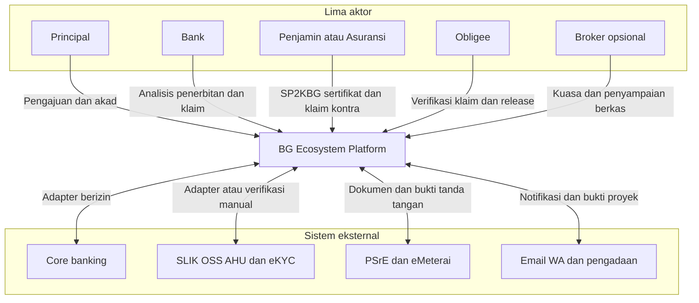
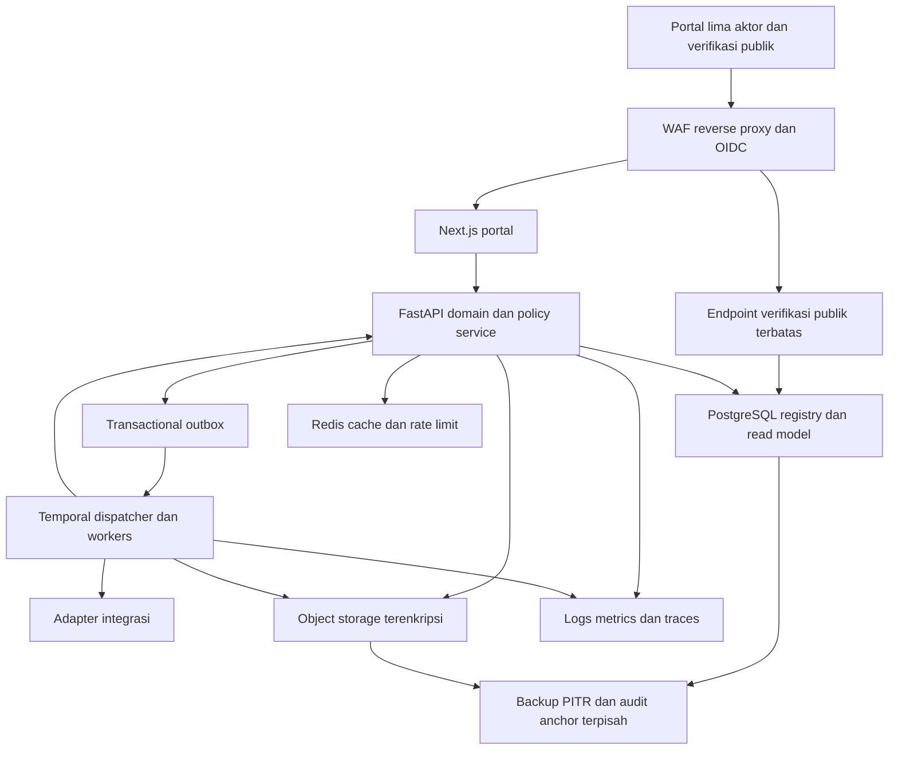
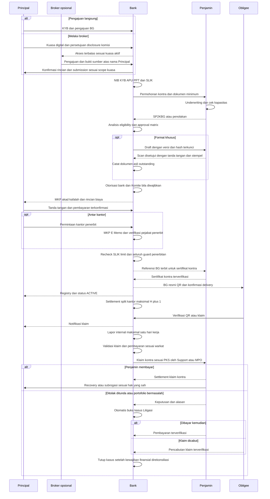
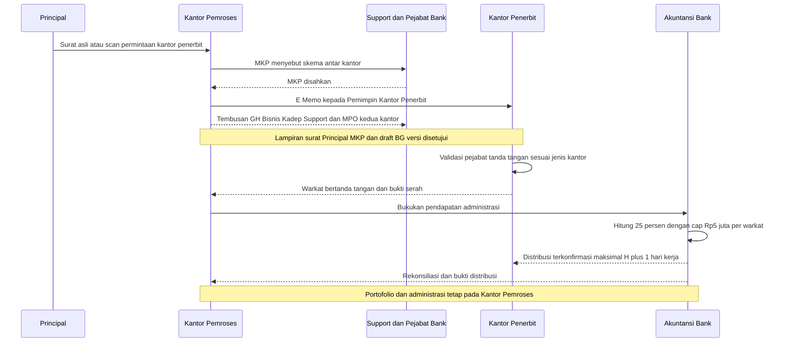
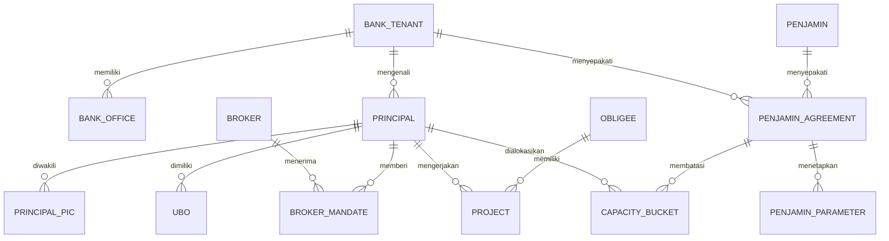
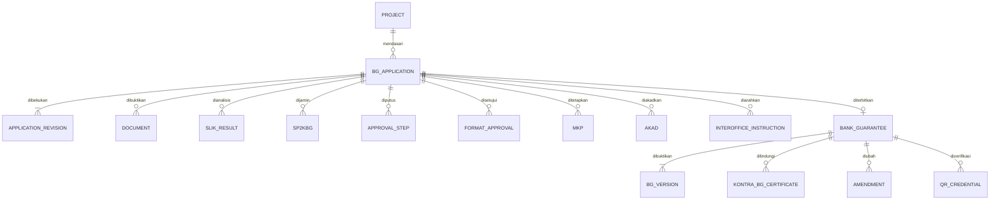
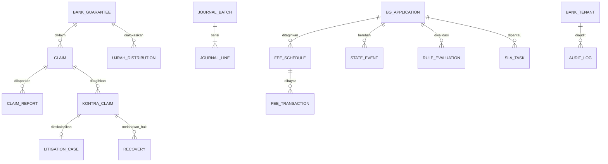
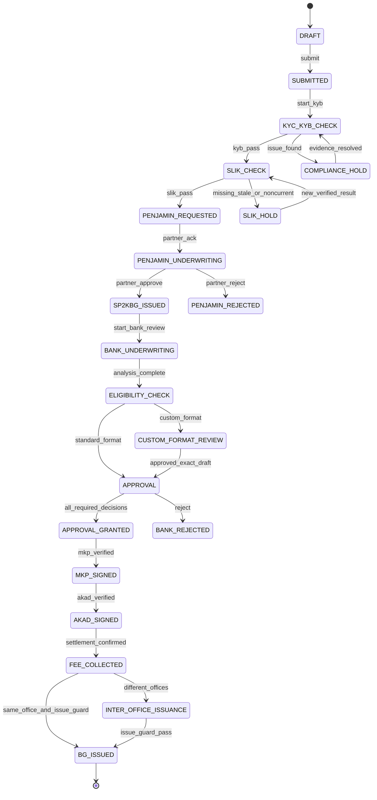
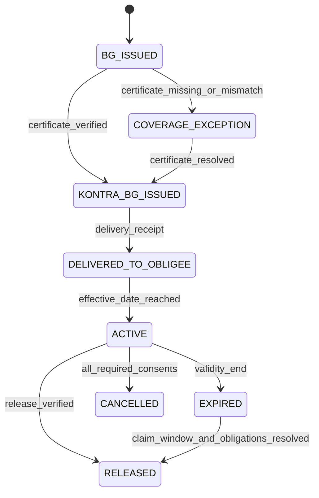
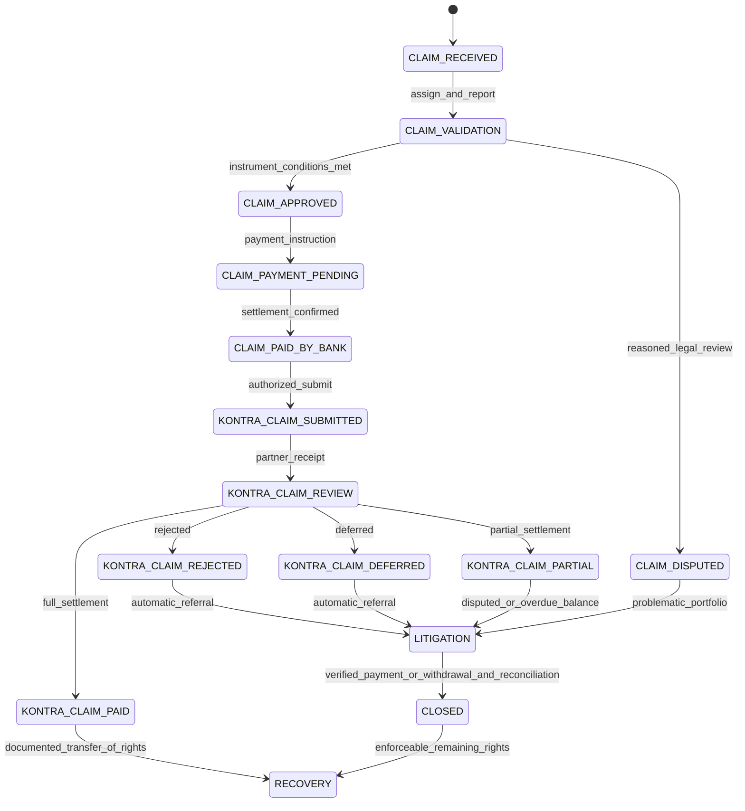

# BG Ecosystem Platform

## Rancangan arsitektur dan proses Bank Garansi syariah

Versi 0.1 • 27 Oktober 2026 • Tahap persetujuan desain • Pemilik keputusan: Bank, Penjamin, Legal, Risk, Compliance, DPS dan Operasional

Dokumen ini menyajikan deliverable 1–4: arsitektur konteks dan container, alur lima aktor, ERD beserta rancangan SQL migrasi, serta state machine dengan guard BR-01–BR-20. Tujuannya menjadi dasar implementasi MVP yang menghubungkan Principal, Bank, Penjamin, Obligee dan Broker opsional dalam satu transaksi yang dapat ditelusuri.

Rekomendasi: satu codebase portal multi-aktor dengan backend modular monolith, PostgreSQL sebagai sumber data kanonis, workflow durable dan adapter integrasi. Pengajuan, kewajiban BG, klaim, litigasi dan recovery memakai aggregate terpisah agar perubahan status satu proses tidak menghilangkan kewajiban proses lain.

**Batas tahap ini:** diagram, kontrak data dan DDL di dalam dokumen adalah rancangan untuk ditinjau; belum ada kode aplikasi, migrasi yang dijalankan, lingkungan live, ataupun klaim kelulusan pengujian. Deliverable 5–10 dikerjakan setelah konfirmasi desain sesuai instruksi pengguna.

### Daftar isi

1. Dasar kebijakan, keputusan dan asumsi
2. Deliverable 1 Arsitektur
3. Deliverable 2 Alur lima aktor
4. Deliverable 3 Model data dan rancangan SQL migrasi
5. Deliverable 4 State machine dan guard
6. Matriks penerimaan dan keputusan sebelum implementasi
7. Referensi

## 1 Dasar kebijakan keputusan dan asumsi

### 1.1 Hierarki sumber

| Lapisan | Sumber | Perlakuan dalam desain |
|---|---|---|
| Peraturan dan fatwa | R1–R7 pada referensi | Acuan regulasi; penerapan pasal per jenis lembaga dikonfirmasi Legal/Compliance/DPS |
| Kebijakan internal bank | Ringkasan SE 051/SE-DRUT/KP-JKT/X/2021 dalam prompt | BR-01–BR-20 adalah kebutuhan pengguna; dokumen asli, penerbit SE, perubahan dan keberlakuannya belum diverifikasi |
| Perjanjian | PKS bank–penjamin, mandat broker, akad, BG dan kontrak proyek | Mengikat transaksi sesuai versi dan tanggal efektif yang telah disahkan |
| Parameter operasional | Kalender, limit, tarif, kewenangan dan SLA | Versioned, maker-checker, efektif bertanggal dan dapat diuji sebelum aktivasi |

Ketentuan SE tersebut tidak diasumsikan berlaku universal untuk semua bank. Jika PKS atau konfigurasi berkonflik dengan kebijakan/regulasi, sistem membuat exception untuk pemeriksaan Legal/Compliance; prioritas tidak ditentukan oleh sekadar “nilai terakhir”. Penerbitan tetap tertahan sampai konflik diselesaikan.

Pemeriksaan sumber per 27 Oktober 2026 menemukan PADK 1 Tahun 2026, berlaku 1 Maret 2026, yang mencabut SEOJK 21/SEOJK.03/2017. Karena itu baseline TI tidak cukup hanya menyebut POJK 11/POJK.03/2022 [R1–R2]. POJK 10 dan 11 Tahun 2025 perlu masuk register pemetaan izin/kelembagaan serta usaha penjamin [R3–R4]. Penerapannya untuk perusahaan penjaminan dan perusahaan asuransi harus dibedakan; izin produk tidak dapat disimpulkan dari nama perusahaan.

Fatwa Kafalah membolehkan imbalan sepanjang tidak memberatkan dan menyatakan kafalah berimbalan mengikat serta tidak dapat dibatalkan sepihak [R5]. Desain tidak menyimpulkan bahwa semua tarif persentase otomatis dilarang atau diperbolehkan. Bentuk tarif, dasar hitung, disclosure, pembatalan dan akad harus memperoleh review DPS.

BR-05 tentang Kol 1 dan bulan penarikan adalah kebijakan yang diberikan pengguna. Rujukan SLIK [R6] mendukung pemetaan ekosistem pelapor, bukan bukti bahwa aturan internal itu berlaku untuk setiap BG di semua bank. Jadwal kewajiban pelaporan dan spesifikasi berkas harus diverifikasi lagi pada implementasi; sistem tidak mengasumsikan adanya API publik SLIK.

### 1.2 Keputusan desain yang diajukan

| ID | Keputusan | Alasan dan konsekuensi |
|---|---|---|
| AD-01 | Backend FastAPI; portal Next.js/TypeScript | Modular, OpenAPI 3.1 dapat diturunkan dan kontrak klien bertipe |
| AD-02 | PostgreSQL; Redis hanya cache/rate limit | Ledger, limit, audit dan state tidak bergantung pada cache |
| AD-03 | Temporal untuk orkestrasi/timer; state bisnis kanonis di PostgreSQL | Worker dapat diulang setelah crash; workflow mengirim command idempoten ke domain service |
| AD-04 | S3-compatible storage, versioning, KMS dan Object Lock bila tersedia | Bukti byte, retensi, legal hold dan checkpoint audit terpisah dari DB |
| AD-05 | OIDC dengan MFA; identitas tunggal dan membership per organisasi | Satu orang dapat memiliki hubungan dengan beberapa organisasi tanpa menggabungkan kewenangan |
| AD-06 | Multi-tenant bank; tenant penjamin/aktor sebagai organisasi terpisah | Transaksi dimiliki bank; akses penjamin hanya pada transaksi dan subset data yang dibagikan |
| AD-07 | PKS, rule dan workflow dibekukan sebagai snapshot per revisi pengajuan | Keputusan lama dapat direproduksi; perubahan material memicu evaluasi ulang |
| AD-08 | MVP memakai IDR; model mendukung mata uang lain | Threshold Rp3 M tidak dipakai pada valas sebelum kebijakan kurs disahkan |
| AD-09 | Default produk BG dengan Kontra BG; skema lain disimpan sebagai exception | Justifikasi saja belum cukup untuk melewati gate SP2KBG pada produk ini |
| AD-10 | Pilot memakai adapter sandbox atau verifikasi manual bersumber primer | Mock tidak menghasilkan bukti penerbitan/settlement nyata |

Ini proyek baru, tidak diasumsikan sebagai modul INDIA/GreenCal dan tidak mengubah repositori atau produksi yang sudah ada.

### 1.3 Parameter awal dan status asumsi

Nilai berikut untuk desain/UAT, bukan representasi PKS pihak mana pun. Semua nilai bertanda “asumsi” berstatus DRAFT dan tidak boleh aktif pada profil produksi.

| Parameter | Contoh nilai | Status atau gate |
|---|---|---|
| Produk default | BG_CONTRA | BR-01 dari prompt |
| Kategori tanpa Komite tambahan | APBN, APBD, BUMN, BUMD, anak usaha yang klasifikasinya disahkan | BR-04; klasifikasi berbukti; JV default membutuhkan Komite |
| Threshold Komite | IDR 3.000.000.000 inklusif untuk GH Bisnis; di atasnya Direksi | BR-04 dari prompt; versi bank |
| SLIK | Kol 1; bulan dan tahun penarikan sama dengan tanggal terbit aktual, Asia/Jakarta | BR-05; dicek ulang pada saat penerbitan |
| Split kantor | 25% × pendapatan administrasi yang dibukukan; cap IDR 5.000.000 per warkat | BR-13; basis sebelum pajak/komponen lain adalah asumsi Akuntansi |
| Distribusi split | Maksimal H+1 hari kerja kalender bank | BR-14; settlement, bukan antrean kirim, menjadi bukti selesai |
| Laporan awal klaim internal | Maksimal 1 hari kerja sejak diterima bank | BR-18; tidak menunggu kelengkapan dokumen |
| Coverage kontra | 100% untuk fixture UAT | Asumsi; parameter produksi wajib PKS |
| Jenis BG contoh | PENAWARAN, PELAKSANAAN, UANG_MUKA, PEMELIHARAAN, PEMBAYARAN, KEPABEANAN, LAINNYA | Master jenis; dukungan setiap jenis wajib dikonfirmasi PKS |
| Tarif bank | Fixed IDR 1.000.000 pada fixture UAT | Asumsi; versi tarif dan persetujuan DPS wajib |
| Tarif penjamin | Fixed IDR 500.000 pada fixture UAT | Asumsi; hanya demonstrasi, bukan penawaran tarif |
| Komisi broker | Fixed IDR 100.000 pada fixture UAT | Asumsi; disclosure dan akad/PKS wajib; dibayar terpisah |
| Limit penjamin–bank | IDR 100 miliar | Asumsi UAT; basis gross/covered exposure harus eksplisit |
| Limit Principal | IDR 10 miliar | Asumsi UAT; scope grup/individual harus eksplisit |
| Tenor maksimum | 365 hari kalender | Asumsi UAT |
| Claim window BG | 30 hari kalender setelah akhir masa berlaku | Asumsi UAT; bukan tenggat klaim kontra |
| Tenggat pengajuan kontra | 5 hari kerja sejak bank membayar klaim | Asumsi UAT; trigger dan durasi wajib diisi sesuai PKS |
| SLA pembayaran penjamin | 15 hari kerja setelah berkas lengkap diakui | Asumsi UAT; tidak menggantikan BR-18 |
| Kalender | Senin–Jumat, Asia/Jakarta, akhir hari 17.00 | Asumsi; kalender hari libur/cuti/pembukuan harus disahkan dan diberi versi |
| Retensi audit/dokumen | Minimum 10 tahun dari penutupan kewajiban terkait | Kebutuhan proyek; legal hold mengalahkan jadwal pemusnahan |
| Media penjamin | Portal manual dengan bukti penerimaan | Asumsi UAT; alamat/API resmi per PKS |

Ketiadaan nilai wajib adalah CONFIG_INCOMPLETE, bukan nol. Tarif nol hanya sah bila disetujui eksplisit. Jika nilai efektif lebih dari satu atau tidak ada, transaksi tertahan; sistem tidak memilih sembarang versi. Perhitungan uang memakai desimal dan rounding currency-specific, bukan floating point.

### 1.4 Tata kelola konfigurasi

Alur konfigurasi: DRAFT → SIMULATED → REVIEWED → APPROVED → SCHEDULED → ACTIVE → SUPERSEDED/REVOKED. Maker tidak dapat menjadi checker, termasuk Admin. Tarif/akad memerlukan DPS, kewenangan memerlukan pejabat bank, dan parameter penjamin memerlukan evidensi PKS. Perubahan efektif tidak mengedit versi lama.

Setiap rule menyimpan kode BR, scope bank/produk/PKS, kondisi terstruktur, efek, severity, tanggal efektif, sumber/hash, versi, maker, approver, alasan perubahan dan referensi pengujian. Kondisi menggunakan DSL yang diizinkan seperti ALL/ANY/EQ/IN/LE/GT/SAME_MONTH/BUSINESS_DAYS; tidak menerima eval, Python, JavaScript atau SQL bebas. Hasil evaluasi menyimpan input fingerprint, versi rule, keputusan dan alasan.

Nilai bisnis dapat dikonfigurasi. Invariant keamanan seperti larangan self-approval, isolasi tenant, larangan broker memutus, integritas ledger dan larangan mock di produksi tetap wajib di lapisan otorisasi/domain dan tidak dapat dimatikan lewat parameter.

## 2 Deliverable 1 Arsitektur

### 2.1 C4 tingkat konteks



Trust boundary: perangkat pengguna dan dokumen unggahan tidak tepercaya; backend memverifikasi identitas, scope dan bukti. Identitas penjamin tidak mewarisi akses bank. Provider eksternal tidak dapat mengubah state secara langsung; callback bertanda tangan diverifikasi, dideduplikasi dan diterjemahkan menjadi command domain.

### 2.2 C4 tingkat container



**Konsistensi:** command bisnis mengunci aggregate, memeriksa version, mengevaluasi guard, memperbarui state, menulis audit dan outbox dalam satu transaksi DB. Workflow bukan sumber status kedua. Dispatcher boleh mengirim lebih dari sekali; consumer wajib idempoten. Setelah crash, reconciler membandingkan outbox, workflow dan core banking sebelum melanjutkan.

### 2.3 Modul domain dan kepemilikan data

| Modul | Data kanonis dan tanggung jawab |
|---|---|
| Identity dan Access | User, membership, role scope, MFA, mandate, resource grant dan revocation |
| Party dan KYB | Principal/PIC/UBO, Obligee, legalitas broker/penjamin, NIB dan verifikasi sumber |
| Product dan Policy | Jenis BG, kategori, rule version, PKS, tarif, limit, kewenangan, kalender |
| Origination | Project, application revision, checklist, SLIK, scoring dan underwriting |
| Guarantee Partner | Permohonan penjamin, SP2KBG, persetujuan format, sertifikat dan kapasitas |
| Decision dan Agreement | Approval steps, MKP, E-Memo, akad dan signature envelope |
| Registry | Nomor BG, revisi warkat, QR token, delivery dan status kewajiban |
| Claims dan Legal | Klaim bank, laporan internal, klaim kontra, litigasi, recovery/subrogasi |
| Finance | Schedule fee, pembayaran, collateral, split ujrah, journal batch dan rekonsiliasi |
| Evidence dan Audit | Object version/hash, verifikasi, legal hold, audit hash chain dan export |
| Operations | SLA, notifikasi, task, exception queue, monitoring dan reporting |

Dashboard dan laporan membaca projection; aksi finansial selalu memeriksa data kanonis. Rekening administratif, amortisasi dan CKPN memakai mapping kebijakan Akuntansi yang disahkan. MVP mencatat jurnal operasional/referensi posting; perhitungan CKPN regulator penuh bukan hasil otomatis tanpa model dan validasi yang disetujui.

### 2.4 Akses lintas organisasi

| Aktor/role | Boleh | Pembatasan utama |
|---|---|---|
| Principal | Membuat, merevisi draft, submit, akad, bayar, mencabut kuasa | Hanya badan usaha yang diwakili sah; tidak approve underwriting |
| AO | Membuat atas permintaan Principal, memeriksa berkas, mengirim ke analis | Scope kantor pemroses; tidak approve buatannya |
| Analis/Risk/Compliance/Legal | Review sesuai tugas, catatan dan rekomendasi | SLIK/UBO hanya sesuai tujuan dan kebutuhan akses |
| GH Bisnis/Direksi | Keputusan Komite sesuai nominal/matrix | Maker dan pihak konflik kepentingan dilarang memutus |
| Support/MPO | MKP, penerbitan, klaim sesuai kantor/jenis kantor | Otorisasi BR-15/17 diverifikasi; bukan kewenangan Admin umum |
| Pengembangan Bisnis | Monitoring, tembusan dan eskalasi | Tidak otomatis memperoleh semua dokumen KYB/SLIK |
| Akuntansi | Settlement, split, jurnal dan rekonsiliasi | Checker berbeda; tidak mengubah nominal BG yang telah disahkan |
| Audit | Membaca bukti dan log dalam scope penugasan | Read-only, tidak download tanpa pencatatan akses |
| Penjamin | Underwriting dan keputusan kontra atas transaksi yang diarahkan kepadanya | Hanya organisasi/rekanan terkait; data minimum dan grant berbatas waktu |
| Obligee | Verifikasi, menerima BG, klaim, mencabut klaim, release | Hanya BG untuk entitasnya; publik tidak mendapat KYB atau berkas klaim |
| Broker | Membuat draft/submit sesuai kuasa, melihat pipeline dan komisi sendiri | Tidak approve; tidak edit setelah submit; akses dicek ulang setiap request |
| Litigasi | Mengelola kasus yang dirujuk, bukti penyelesaian | Penutupan membutuhkan settlement/withdrawal terverifikasi |
| Admin konfigurasi | Menyiapkan konfigurasi dan membership sesuai mandat | Tidak menyetujui konfigurasi/keputusan sendiri; tidak membaca semua data secara otomatis |

Autorisasi = identitas valid ∩ membership aktif ∩ role/action ∩ bank/office scope ∩ resource grant ∩ status ∩ SoD ∩ mandate bila broker. PostgreSQL RLS memberi lapisan tambahan; aplikasi tidak menggunakan akun DB yang bypass RLS. Konteks pengguna dipasang secara lokal per transaksi untuk mencegah kebocoran pada connection pool. Dedicated workload role terpisah untuk worker, migrator dan auditor.

Revokasi kuasa langsung memblokir request berikutnya, sesi cache diinvalidasi, download token pendek dicabut bila masih dapat dikendalikan. Bytes yang telah diunduh tidak dapat ditarik kembali; setiap unduhan di-watermark dan diaudit. Principal tetap dapat melanjutkan langsung. Dokumen broker memerlukan verified_by/source_reference dari sumber primer dan tidak dipercaya hanya karena berkas diunggah broker.

### 2.5 Integrasi dan bukti keaslian

Setiap adapter punya mode MOCK/SANDBOX/LIVE/MANUAL_VERIFIED, capability, schema version, timeout, retry, signature verification dan referensi eksternal. MOCK hanya profil dev/test, watermark jelas, credential terpisah; production readiness menolak fixture/mock. Manual fallback menghasilkan task verifikasi oleh petugas berwenang dengan bukti sumber dan checker, bukan tombol “anggap berhasil”.

| Adapter | Input/output pokok | Penanganan kegagalan |
|---|---|---|
| Core banking | Posting fee/collateral/off-balance, inquiry settlement, reversal | Status UNKNOWN menahan penerbitan; inquiry sebelum retry; external reference unik |
| SLIK | Request berwenang, hasil terverifikasi dan tanggal tarik | Tidak ada akses resmi → upload iDeb oleh petugas sah + verifikasi; bukan kolom Kol 1 bebas |
| OSS/AHU/eKYC | Legalitas NIB, perusahaan, pengurus dan UBO | Mismatch membuat KYB hold; API tidak diasumsikan tersedia publik |
| Penjamin | Request, SP2KBG, endorsement, klaim dan settlement | Poll/reconcile atau portal manual sesuai PKS; deduplikasi nomor dan hash |
| PSrE/eMeterai | Digest dokumen, signer authority, envelope, sertifikat | Validasi callback dan sertifikat; bukti eMeterai terpisah dari tanda tangan |
| Pengadaan | Referensi tender/kontrak | Bukan syarat otomatis bila akses/sumber tidak tersedia; review manual |
| Email/WA | Pemberitahuan minimal dan link aman | Delivery failure menjadi task; kanal tidak memuat SLIK/UBO atau URL dokumen permanen |

Nomor BG unik bank + tahun + seri yang dialokasikan atomik; nomor batal tidak didaur ulang. QR memakai token acak berentropi tinggi, hanya digest token tersimpan, rate limiting dan token rotation/revocation. QR memuat URL verifikasi, bukan salinan data rahasia. Verifikasi memeriksa registry kanonis, revisi dan hash warkat; QR yang disalin dari BG asli tidak membuktikan bahwa nominal/nama pada kertas palsu sama, sehingga portal meminta pencocokan atribut BG.

Respons publik membedakan NOT_FOUND, AUTHENTIC_ACTIVE, AUTHENTIC_EXPIRED, REPLACED, RELEASED, CANCELLED, REVOKED. Tampilan Indonesia menyatakan “asli dan masih berlaku” atau “asli tetapi masa berlaku berakhir”; token palsu menyatakan “tidak ditemukan/tidak valid”. Field authenticity, validity dan claim_window_open terpisah. Klaim dapat masih diterima ketika masa berlaku BG berakhir apabila ketentuan klaim mengizinkannya. Publik hanya melihat nomor/jenis/status, nama pihak sesuai disclosure, nominal/mata uang dan tanggal; data lain untuk Obligee terautentikasi.

### 2.6 Keamanan keandalan dan operasi

Target 99,5% per bulan, RPO ≤15 menit dan RTO ≤4 jam adalah sasaran yang harus dibuktikan, bukan jaminan dari pilihan teknologi. Perlu pengukuran uptime, alarm, PostgreSQL PITR/WAL continuous archive, backup terenkripsi di failure domain terpisah, restore drill DB+object+key, serta rekonsiliasi pembayaran setelah restore. Redis dapat hilang tanpa kehilangan data bisnis. Temporal memakai storage durable terpisah dan prosedur recovery; bukti bisnis tetap dapat direkonsiliasi dari DB/outbox.

| Area | Kontrol yang dirancang |
|---|---|
| Infrastruktur | Dev Docker Compose; produksi layanan container HA/managed atau Kubernetes bila operasi siap; jaringan privat DB/storage; residency dan akses vendor mengikuti review bank |
| Auth | MFA, session expiry, step-up untuk keputusan/penandatanganan/pembayaran, service identity mTLS/OAuth |
| Data | TLS, envelope encryption KMS, field sensitif terenkripsi, key rotation, akses minimum dan pemisahan data tiap bank |
| Upload | Allowlist format/ukuran, antivirus, deteksi MIME, quarantine, PDF active-content sanitization; render hasil aman tanpa menimpa dokumen asli |
| Aplikasi | ASVS L2 sebagai baseline verifikasi, CSRF/XSS/IDOR/injection checks, rate limit dan replay protection |
| Audit | Canonical event hash dengan previous_hash; per-bank chain serial; checkpoint bertanda tangan di media terpisah/Object Lock; verifikasi rutin dan deteksi penghapusan/rollback |
| Privasi | Data minimization, purpose/access logging, consent atau dasar pemrosesan lain yang relevan, retention schedule dan legal hold; tidak log payload SLIK/UBO |
| Operasi | Structured log tanpa rahasia, correlation/trace ID, metrics SLA/backlog/reconciliation, alert dan incident runbook |

Hash chain sendiri hanya tamper-evident; DBA yang dapat menulis ulang seluruh rantai perlu dibatasi dengan signed anchor eksternal, separation of duties dan immutable storage. Audit hash memuat digest bukti, bukan PII mentah agar retensi audit tidak otomatis memperluas penyimpanan PII.

## 3 Deliverable 2 Alur lima aktor

### 3.1 Swimlane jalur utama dengan dan tanpa broker

Diagram memakai lima participant agar tanggung jawab lintas aktor terlihat; peran internal bank dijabarkan pada tabel tahap berikutnya.



Kuasa tidak selalu mengizinkan broker menandatangani akad atau menyampaikan klaim. Setiap tindakan memiliki scope tersendiri; default akad tetap dilakukan penandatangan Principal yang sah. Pencabutan kuasa adalah jalur kapan saja, tidak menunggu pengajuan kembali DRAFT.

### 3.2 Swimlane penerbitan antar kantor



Satu bank tetap satu penerbit hukum; kantor pemroses dan kantor penerbit warkat tidak menjadi tenant independen. Tembusan E-Memo tidak memberikan hak melihat semua berkas pengajuan.

### 3.3 Serah terima per tahap

| Tahap | Maker → checker/penerima | Bukti dan keluaran | SLA/gate |
|---|---|---|---|
| KYB | Principal/AO → Compliance | NIB, akta/AHU, NPWP, PIC/UBO, screening | TDP tidak menggantikan NIB; source verified |
| SLIK | Petugas berwenang → analis/checker | iDeb/hasil adapter, tanggal tarik, kualitas | Kol 1, bulan penerbitan aktual |
| Penjamin | AO/operasional → underwriter penjamin | Permohonan, PKS version, SP2KBG | Rekanan dan PKS aktif; limit dan kewenangan |
| Bank | Analis → pejabat bank dan Komite bila perlu | Memo analisis, rule decisions | T1 tanpa Komite tambahan tetap melalui otorisasi bank |
| Format khusus | Bank → pejabat penjamin | Exact draft hash, scan persetujuan, TTD/stempel | Perubahan satu byte membatalkan approval terkait |
| MKP/akad | Pejabat bank/Principal → pihak penanda tangan | Signature envelope dan dokumen final | Otoritas penanda tangan dan SoD |
| Pembayaran | Principal → Finance/core banking | Settlement fee, IJP, collateral jika diwajibkan | Bukti upload saja belum FEE_COLLECTED |
| Penerbitan | MPO/Support → pejabat penerbit | Warkat bernomor, signed hash, QR | BR-02–15 dan limit dicek ulang |
| Delivery | Bank → Obligee | Sertifikat kontra, delivery receipt | Exception sertifikat tidak menghapus kewajiban BG yang telah terbit |
| Klaim | Obligee → Support/MPO dan unit bisnis | Claim receipt, laporan internal, dokumen | BR-18 berjalan sejak receipt, bukan sejak lengkap |
| Kontra/litigasi | Support/MPO → Penjamin/Litigasi | Bukti submit/keputusan/settlement | SLA PKS terpisah; BR-20 otomatis |
| Recovery | Penjamin atau kuasanya → Principal | Bukti peralihan hak, tagihan, settlement | Tidak ada pemulihan ganda atau penagihan melebihi hak |

## 4 Deliverable 3 Model data dan rancangan SQL migrasi

### 4.1 Konvensi dan constraint

Semua data transaksi dimiliki bank_tenant. Hubungan lintas organisasi ditentukan membership dan resource grant, bukan parameter tenant dari body request. Seluruh FK transaksi memakai pasangan bank_id dan id; id yang valid dari bank lain tetap gagal FK. Identitas global hanya menyimpan referensi organisasi dan identitas autentikasi; NIB, UBO dan bukti sensitif berada dalam ruang bank.

- ID memakai UUID; nomor bisnis memiliki unique constraint tersendiri. Tanggal efektif menggunakan rentang awal inklusif dan akhir eksklusif. Timestamp disimpan UTC dengan timezone; kalender bisnis Asia/Jakarta diberi versi.
- Uang memakai NUMERIC(24,2), persentase NUMERIC(9,6); mata uang memakai master tervalidasi. Interest/daycount tidak diasumsikan sebagai skema ujrah; formula tarif disahkan DPS.
- Application memiliki revision dan lock_version. Seluruh approval, SP2KBG, MKP, akad dan format mengacu revisi/hash. Perubahan material membuat revisi baru, membatalkan approval terdampak dan menghitung ulang kapasitas.
- Satu application dapat memiliki banyak revisi, hasil SLIK, dokumen, keputusan dan claim; satu BG diterbitkan untuk application, dengan banyak versi warkat/amendment.
- Application.party_snapshot membekukan data pihak saat keputusan; master party berubah tidak mengubah warkat lama.
- Penghapusan transaksi yang telah disubmit tidak diperbolehkan; pembatalan, revokasi dan koreksi adalah event baru. Data draft dapat dihapus sesuai retention policy dan pencatatan audit.
- Limit memakai reservation aktif + outstanding exposure; row capacity dikunci dalam transaksi yang sama dengan reserve/issue. Mengubah coverage/nominal/tenor wajib delta check, bukan menghitung ulang dari cache.

### 4.2 ERD pihak dan perjanjian



### 4.3 ERD pengajuan keputusan dan registry



### 4.4 ERD klaim dan keuangan



Kasus litigasi karena sengketa dapat dibuka sebelum keputusan penjamin dan karena itu FK kontra_claim bersifat opsional; klaim utama tetap wajib. Recovery dapat timbul untuk bank maupun penjamin sesuai dasar hak; field rights_holder_org_id dan rights_basis_doc_id membedakannya. Kardinalitas pada diagram menyederhanakan beberapa tabel pendukung yang dijabarkan di SQL.

### 4.5 Register migrasi

| Migrasi rancangan | Objek utama | Gate penerapan kelak |
|---|---|---|
| 0001_identity_party | Tenant, organization, user, membership, office, party, broker/mandate, project | Isolasi tenant dan legal identity |
| 0002_policy | Rule/workflow version, PKS/parameter, kalender, capacity | Effective version tidak overlap; maker-checker |
| 0003_origination | Application/revision, dokumen, KYB/SLIK, SP2KBG, approval/MKP/akad/format | Dokumen/version binding |
| 0004_registry_finance | BG/version/QR, sertifikat, amendment, fee, split, journal | Atomic issue dan ledger balanced |
| 0005_claims | Claim/report/kontra/litigasi/recovery | SLA dan referential integrity |
| 0006_operations_audit | Event, SLA, notification, outbox/inbox, rule evaluation, audit | Idempotency dan chain anchoring |
| 0007_security_constraints | RLS policies, immutable guards, deferred journal check, range exclusion | Negative RBAC/ABAC/SoD dan race tests |
| 0008_development_seed | Fixture terpisah, tidak untuk production | Profil dev/test saja |

DDL berikut adalah **draft struktur** dalam dokumen desain, bukan paket migrasi siap dijalankan. Kebijakan RLS, fungsi transisi, exclusion effective-date, trigger immutable dan balancing ledger termasuk 0007 dan baru ditulis setelah persetujuan kode. Karena itu struktur ini belum boleh dipakai untuk layanan pengguna nyata. CREATE TABLE di bawah tidak menyatakan bahwa guard lintas baris sudah diimplementasikan.

### 4.6 SQL rancangan struktur

```sql
-- 0001_identity_party — UUID disuplai service, bukan nomor bisnis.
CREATE TABLE organization (
  id uuid PRIMARY KEY, kind text NOT NULL, display_name text NOT NULL
);
CREATE TABLE bank_tenant (
  id uuid PRIMARY KEY, organization_id uuid NOT NULL UNIQUE REFERENCES organization(id),
  code text NOT NULL UNIQUE, environment text NOT NULL
);
CREATE TABLE app_user (
  id uuid PRIMARY KEY, oidc_issuer text NOT NULL, oidc_subject text NOT NULL,
  active boolean NOT NULL DEFAULT true, UNIQUE (oidc_issuer, oidc_subject)
);
CREATE TABLE bank_office (
  bank_id uuid NOT NULL REFERENCES bank_tenant(id), id uuid NOT NULL,
  code text NOT NULL, name text NOT NULL, office_type text NOT NULL,
  active boolean NOT NULL DEFAULT true, PRIMARY KEY(bank_id,id), UNIQUE(bank_id,code)
);
CREATE TABLE membership (
  bank_id uuid NOT NULL REFERENCES bank_tenant(id), id uuid NOT NULL, user_id uuid NOT NULL REFERENCES app_user(id),
  organization_id uuid NOT NULL REFERENCES organization(id), office_id uuid,
  role_code text NOT NULL, valid_from timestamptz NOT NULL, valid_to timestamptz,
  revoked_at timestamptz, PRIMARY KEY(bank_id,id),
  FOREIGN KEY(bank_id,office_id) REFERENCES bank_office(bank_id,id),
  CHECK(valid_to IS NULL OR valid_to>valid_from)
);
CREATE TABLE principal (
  bank_id uuid NOT NULL REFERENCES bank_tenant(id), id uuid NOT NULL,
  organization_id uuid NOT NULL REFERENCES organization(id), legal_name text NOT NULL,
  entity_type text NOT NULL, nib text, npwp_ciphertext bytea, kyb_status text NOT NULL,
  PRIMARY KEY(bank_id,id), UNIQUE(bank_id,nib)
);
CREATE TABLE principal_pic (
  bank_id uuid NOT NULL REFERENCES bank_tenant(id), id uuid NOT NULL, principal_id uuid NOT NULL,
  person_ciphertext bytea NOT NULL, authority_evidence_ref text NOT NULL,
  verified_at timestamptz, PRIMARY KEY(bank_id,id),
  FOREIGN KEY(bank_id,principal_id) REFERENCES principal(bank_id,id)
);
CREATE TABLE ubo (
  bank_id uuid NOT NULL REFERENCES bank_tenant(id), id uuid NOT NULL, principal_id uuid NOT NULL,
  identity_ciphertext bytea NOT NULL, ownership_pct numeric(9,6), control_basis text,
  screening_status text NOT NULL, PRIMARY KEY(bank_id,id),
  FOREIGN KEY(bank_id,principal_id) REFERENCES principal(bank_id,id),
  CHECK(ownership_pct IS NULL OR ownership_pct BETWEEN 0 AND 100)
);
CREATE TABLE obligee (
  bank_id uuid NOT NULL REFERENCES bank_tenant(id), id uuid NOT NULL,
  organization_id uuid NOT NULL REFERENCES organization(id), legal_name text NOT NULL,
  category_code text NOT NULL, classification_evidence_ref text,
  classified_by uuid REFERENCES app_user(id), PRIMARY KEY(bank_id,id)
);
CREATE TABLE broker (
  bank_id uuid NOT NULL REFERENCES bank_tenant(id), id uuid NOT NULL,
  organization_id uuid NOT NULL REFERENCES organization(id), legal_name text NOT NULL,
  activity_scope text NOT NULL, license_reference text, license_valid_to date,
  license_verified_at timestamptz, whitelist_status text NOT NULL,
  conflict_status text NOT NULL, PRIMARY KEY(bank_id,id)
);
CREATE TABLE broker_mandate (
  bank_id uuid NOT NULL REFERENCES bank_tenant(id), id uuid NOT NULL, principal_id uuid NOT NULL, broker_id uuid NOT NULL,
  scope_json jsonb NOT NULL, signed_doc_hash char(64) NOT NULL,
  valid_from timestamptz NOT NULL, valid_to timestamptz NOT NULL, revoked_at timestamptz,
  PRIMARY KEY(bank_id,id), FOREIGN KEY(bank_id,principal_id) REFERENCES principal(bank_id,id),
  FOREIGN KEY(bank_id,broker_id) REFERENCES broker(bank_id,id), CHECK(valid_to>valid_from)
);
CREATE TABLE penjamin (
  bank_id uuid NOT NULL REFERENCES bank_tenant(id), id uuid NOT NULL,
  organization_id uuid NOT NULL REFERENCES organization(id), legal_name text NOT NULL,
  institution_type text NOT NULL, permitted_products jsonb NOT NULL,
  license_reference text, operating_region jsonb NOT NULL, active boolean NOT NULL,
  PRIMARY KEY(bank_id,id)
);
CREATE TABLE project (
  bank_id uuid NOT NULL REFERENCES bank_tenant(id), id uuid NOT NULL, principal_id uuid NOT NULL, obligee_id uuid NOT NULL,
  name text NOT NULL, contract_number text NOT NULL, project_value numeric(24,2),
  contract_doc_ref text, PRIMARY KEY(bank_id,id),
  FOREIGN KEY(bank_id,principal_id) REFERENCES principal(bank_id,id),
  FOREIGN KEY(bank_id,obligee_id) REFERENCES obligee(bank_id,id),
  CHECK(project_value IS NULL OR project_value>0)
);

-- 0002_policy
CREATE TABLE policy_version (
  bank_id uuid NOT NULL REFERENCES bank_tenant(id), id uuid NOT NULL,
  code text NOT NULL, version integer NOT NULL CHECK(version>0), status text NOT NULL,
  effective_from date NOT NULL, effective_to date, rules_json jsonb NOT NULL,
  source_hash char(64) NOT NULL, maker_id uuid NOT NULL REFERENCES app_user(id),
  checker_id uuid REFERENCES app_user(id), dps_reference text,
  PRIMARY KEY(bank_id,id), UNIQUE(bank_id,code,version),
  CHECK(effective_to IS NULL OR effective_to>effective_from),
  CHECK(checker_id IS NULL OR checker_id<>maker_id)
);
CREATE TABLE workflow_version (
  bank_id uuid NOT NULL REFERENCES bank_tenant(id), id uuid NOT NULL,
  code text NOT NULL, version integer NOT NULL, status text NOT NULL,
  definition_json jsonb NOT NULL, definition_hash char(64) NOT NULL,
  PRIMARY KEY(bank_id,id), UNIQUE(bank_id,code,version)
);
CREATE TABLE calendar_version (
  bank_id uuid NOT NULL REFERENCES bank_tenant(id), id uuid NOT NULL,
  code text NOT NULL, version integer NOT NULL, timezone text NOT NULL,
  working_days jsonb NOT NULL, holidays jsonb NOT NULL, cutoff_local time NOT NULL,
  PRIMARY KEY(bank_id,id), UNIQUE(bank_id,code,version)
);
CREATE TABLE penjamin_agreement (
  bank_id uuid NOT NULL REFERENCES bank_tenant(id), id uuid NOT NULL, penjamin_id uuid NOT NULL,
  agreement_code text NOT NULL, version integer NOT NULL, status text NOT NULL,
  effective_from date NOT NULL, effective_to date NOT NULL,
  signed_doc_hash char(64) NOT NULL, approval_reference text,
  PRIMARY KEY(bank_id,id), UNIQUE(bank_id,agreement_code,version),
  FOREIGN KEY(bank_id,penjamin_id) REFERENCES penjamin(bank_id,id),
  CHECK(effective_to>effective_from)
);
CREATE TABLE penjamin_parameter (
  bank_id uuid NOT NULL REFERENCES bank_tenant(id), id uuid NOT NULL, agreement_id uuid NOT NULL,
  parameter_key text NOT NULL, bg_type text NOT NULL, parameter_value jsonb NOT NULL,
  source_clause text NOT NULL, is_assumption boolean NOT NULL DEFAULT true,
  PRIMARY KEY(bank_id,id), UNIQUE(bank_id,agreement_id,parameter_key,bg_type),
  FOREIGN KEY(bank_id,agreement_id) REFERENCES penjamin_agreement(bank_id,id)
);
CREATE TABLE capacity_bucket (
  bank_id uuid NOT NULL REFERENCES bank_tenant(id), id uuid NOT NULL, agreement_id uuid NOT NULL, principal_id uuid,
  scope_key text NOT NULL, currency char(3) NOT NULL, exposure_basis text NOT NULL,
  limit_amount numeric(24,2) NOT NULL CHECK(limit_amount>=0),
  reserved_amount numeric(24,2) NOT NULL DEFAULT 0 CHECK(reserved_amount>=0),
  outstanding_amount numeric(24,2) NOT NULL DEFAULT 0 CHECK(outstanding_amount>=0),
  lock_version bigint NOT NULL DEFAULT 0, PRIMARY KEY(bank_id,id),
  UNIQUE(bank_id,agreement_id,scope_key,currency),
  FOREIGN KEY(bank_id,agreement_id) REFERENCES penjamin_agreement(bank_id,id),
  FOREIGN KEY(bank_id,principal_id) REFERENCES principal(bank_id,id)
);

-- 0003_origination
CREATE TABLE bg_application (
  bank_id uuid NOT NULL REFERENCES bank_tenant(id), id uuid NOT NULL, application_no text NOT NULL,
  principal_id uuid NOT NULL, project_id uuid NOT NULL, agreement_id uuid NOT NULL,
  processing_office_id uuid NOT NULL, issuing_office_id uuid NOT NULL, broker_mandate_id uuid,
  product_code text NOT NULL, bg_type text NOT NULL, amount numeric(24,2) NOT NULL CHECK(amount>0),
  currency char(3) NOT NULL, planned_issue_on date NOT NULL, expires_on date NOT NULL,
  custom_format boolean NOT NULL DEFAULT false, alternate_scheme_reason text,
  state text NOT NULL, revision integer NOT NULL DEFAULT 1 CHECK(revision>0),
  lock_version bigint NOT NULL DEFAULT 0, policy_version_id uuid NOT NULL,
  workflow_version_id uuid NOT NULL, created_by uuid NOT NULL REFERENCES app_user(id),
  created_at timestamptz NOT NULL, PRIMARY KEY(bank_id,id), UNIQUE(bank_id,application_no),
  FOREIGN KEY(bank_id,principal_id) REFERENCES principal(bank_id,id),
  FOREIGN KEY(bank_id,project_id) REFERENCES project(bank_id,id),
  FOREIGN KEY(bank_id,agreement_id) REFERENCES penjamin_agreement(bank_id,id),
  FOREIGN KEY(bank_id,processing_office_id) REFERENCES bank_office(bank_id,id),
  FOREIGN KEY(bank_id,issuing_office_id) REFERENCES bank_office(bank_id,id),
  FOREIGN KEY(bank_id,broker_mandate_id) REFERENCES broker_mandate(bank_id,id),
  FOREIGN KEY(bank_id,policy_version_id) REFERENCES policy_version(bank_id,id),
  FOREIGN KEY(bank_id,workflow_version_id) REFERENCES workflow_version(bank_id,id),
  CHECK(expires_on>=planned_issue_on)
);
CREATE TABLE application_revision (
  bank_id uuid NOT NULL REFERENCES bank_tenant(id), application_id uuid NOT NULL, revision integer NOT NULL,
  snapshot_json jsonb NOT NULL, snapshot_hash char(64) NOT NULL,
  created_at timestamptz NOT NULL, PRIMARY KEY(bank_id,application_id,revision),
  FOREIGN KEY(bank_id,application_id) REFERENCES bg_application(bank_id,id)
);
CREATE TABLE document (
  bank_id uuid NOT NULL REFERENCES bank_tenant(id), id uuid NOT NULL, application_id uuid,
  owner_org_id uuid NOT NULL REFERENCES organization(id), document_type text NOT NULL,
  object_key text NOT NULL, object_version text NOT NULL, sha256 char(64) NOT NULL,
  source_type text NOT NULL, primary_source_reference text, verification_status text NOT NULL,
  verified_by uuid REFERENCES app_user(id), verified_at timestamptz,
  malware_status text NOT NULL, original_status text NOT NULL,
  retention_until timestamptz NOT NULL, legal_hold boolean NOT NULL DEFAULT false,
  created_at timestamptz NOT NULL, PRIMARY KEY(bank_id,id), UNIQUE(bank_id,object_key,object_version),
  FOREIGN KEY(bank_id,application_id) REFERENCES bg_application(bank_id,id)
);
CREATE TABLE resource_grant (
  bank_id uuid NOT NULL REFERENCES bank_tenant(id), id uuid NOT NULL, application_id uuid NOT NULL,
  grantee_org_id uuid NOT NULL REFERENCES organization(id), allowed_fields jsonb NOT NULL,
  allowed_actions jsonb NOT NULL, valid_to timestamptz, revoked_at timestamptz,
  PRIMARY KEY(bank_id,id), FOREIGN KEY(bank_id,application_id) REFERENCES bg_application(bank_id,id)
);
CREATE TABLE kyb_check (
  bank_id uuid NOT NULL REFERENCES bank_tenant(id), id uuid NOT NULL, principal_id uuid NOT NULL,
  check_type text NOT NULL, outcome text NOT NULL, source_doc_id uuid NOT NULL,
  checked_at timestamptz NOT NULL, checked_by uuid NOT NULL REFERENCES app_user(id),
  PRIMARY KEY(bank_id,id), FOREIGN KEY(bank_id,principal_id) REFERENCES principal(bank_id,id),
  FOREIGN KEY(bank_id,source_doc_id) REFERENCES document(bank_id,id)
);
CREATE TABLE slik_result (
  bank_id uuid NOT NULL REFERENCES bank_tenant(id), id uuid NOT NULL, application_id uuid NOT NULL, revision integer NOT NULL,
  pulled_at timestamptz NOT NULL, data_position_on date, worst_collectibility integer,
  outcome text NOT NULL, document_id uuid NOT NULL, verified_by uuid REFERENCES app_user(id),
  PRIMARY KEY(bank_id,id), FOREIGN KEY(bank_id,application_id,revision)
    REFERENCES application_revision(bank_id,application_id,revision),
  FOREIGN KEY(bank_id,document_id) REFERENCES document(bank_id,id),
  CHECK(worst_collectibility IS NULL OR worst_collectibility BETWEEN 1 AND 5)
);
CREATE TABLE sp2kbg (
  bank_id uuid NOT NULL REFERENCES bank_tenant(id), id uuid NOT NULL, application_id uuid NOT NULL, revision integer NOT NULL,
  agreement_id uuid NOT NULL, reference_no text NOT NULL, issuing_unit text NOT NULL,
  authority_reference text NOT NULL, valid_from date NOT NULL, valid_to date NOT NULL,
  approved_amount numeric(24,2) NOT NULL CHECK(approved_amount>0), currency char(3) NOT NULL,
  coverage_pct numeric(9,6) NOT NULL CHECK(coverage_pct>0 AND coverage_pct<=100),
  document_id uuid NOT NULL, status text NOT NULL,
  PRIMARY KEY(bank_id,id), UNIQUE(bank_id,agreement_id,reference_no),
  FOREIGN KEY(bank_id,application_id,revision) REFERENCES application_revision(bank_id,application_id,revision),
  FOREIGN KEY(bank_id,agreement_id) REFERENCES penjamin_agreement(bank_id,id),
  FOREIGN KEY(bank_id,document_id) REFERENCES document(bank_id,id), CHECK(valid_to>=valid_from)
);
CREATE TABLE approval_step (
  bank_id uuid NOT NULL REFERENCES bank_tenant(id), id uuid NOT NULL, application_id uuid NOT NULL, revision integer NOT NULL,
  step_code text NOT NULL, required_role text NOT NULL, matrix_snapshot jsonb NOT NULL,
  maker_id uuid NOT NULL REFERENCES app_user(id), checker_id uuid REFERENCES app_user(id),
  decision text NOT NULL, reason text, decided_at timestamptz, input_hash char(64) NOT NULL,
  PRIMARY KEY(bank_id,id), UNIQUE(bank_id,application_id,revision,step_code),
  FOREIGN KEY(bank_id,application_id,revision) REFERENCES application_revision(bank_id,application_id,revision),
  CHECK(checker_id IS NULL OR checker_id<>maker_id)
);
CREATE TABLE format_approval (
  bank_id uuid NOT NULL REFERENCES bank_tenant(id), id uuid NOT NULL, application_id uuid NOT NULL, revision integer NOT NULL,
  draft_doc_id uuid NOT NULL, approved_hash char(64) NOT NULL, evidence_doc_id uuid NOT NULL,
  penjamin_approver_ref text NOT NULL, status text NOT NULL, approved_at timestamptz,
  original_due_at timestamptz, original_received_at timestamptz,
  PRIMARY KEY(bank_id,id), FOREIGN KEY(bank_id,application_id,revision)
    REFERENCES application_revision(bank_id,application_id,revision),
  FOREIGN KEY(bank_id,draft_doc_id) REFERENCES document(bank_id,id),
  FOREIGN KEY(bank_id,evidence_doc_id) REFERENCES document(bank_id,id)
);
CREATE TABLE signature_envelope (
  bank_id uuid NOT NULL REFERENCES bank_tenant(id), id uuid NOT NULL, document_id uuid NOT NULL,
  provider_code text NOT NULL, provider_reference text NOT NULL, document_hash char(64) NOT NULL,
  signers_snapshot jsonb NOT NULL, verification_result jsonb NOT NULL, status text NOT NULL,
  PRIMARY KEY(bank_id,id), UNIQUE(bank_id,provider_code,provider_reference),
  FOREIGN KEY(bank_id,document_id) REFERENCES document(bank_id,id)
);
CREATE TABLE mkp (
  bank_id uuid NOT NULL REFERENCES bank_tenant(id), id uuid NOT NULL, application_id uuid NOT NULL, revision integer NOT NULL,
  document_id uuid NOT NULL, signature_envelope_id uuid NOT NULL,
  interoffice_authorized boolean NOT NULL DEFAULT false, signed_at timestamptz,
  PRIMARY KEY(bank_id,id), FOREIGN KEY(bank_id,application_id,revision)
    REFERENCES application_revision(bank_id,application_id,revision),
  FOREIGN KEY(bank_id,document_id) REFERENCES document(bank_id,id),
  FOREIGN KEY(bank_id,signature_envelope_id) REFERENCES signature_envelope(bank_id,id)
);
CREATE TABLE akad (
  bank_id uuid NOT NULL REFERENCES bank_tenant(id), id uuid NOT NULL, application_id uuid NOT NULL, revision integer NOT NULL,
  akad_type text NOT NULL, dps_reference text NOT NULL, document_id uuid NOT NULL,
  signature_envelope_id uuid NOT NULL, signed_at timestamptz,
  PRIMARY KEY(bank_id,id), FOREIGN KEY(bank_id,application_id,revision)
    REFERENCES application_revision(bank_id,application_id,revision),
  FOREIGN KEY(bank_id,document_id) REFERENCES document(bank_id,id),
  FOREIGN KEY(bank_id,signature_envelope_id) REFERENCES signature_envelope(bank_id,id)
);
CREATE TABLE interoffice_instruction (
  bank_id uuid NOT NULL REFERENCES bank_tenant(id), id uuid NOT NULL, application_id uuid NOT NULL, revision integer NOT NULL,
  principal_request_doc_id uuid NOT NULL, mkp_id uuid NOT NULL, draft_doc_id uuid NOT NULL,
  ememo_doc_id uuid NOT NULL, recipient_snapshot jsonb NOT NULL,
  sent_at timestamptz, acknowledged_at timestamptz, status text NOT NULL,
  PRIMARY KEY(bank_id,id), FOREIGN KEY(bank_id,application_id,revision)
    REFERENCES application_revision(bank_id,application_id,revision),
  FOREIGN KEY(bank_id,principal_request_doc_id) REFERENCES document(bank_id,id),
  FOREIGN KEY(bank_id,mkp_id) REFERENCES mkp(bank_id,id),
  FOREIGN KEY(bank_id,draft_doc_id) REFERENCES document(bank_id,id),
  FOREIGN KEY(bank_id,ememo_doc_id) REFERENCES document(bank_id,id)
);
CREATE TABLE capacity_reservation (
  bank_id uuid NOT NULL REFERENCES bank_tenant(id), id uuid NOT NULL, bucket_id uuid NOT NULL, application_id uuid NOT NULL,
  amount numeric(24,2) NOT NULL CHECK(amount>0), status text NOT NULL,
  expires_at timestamptz NOT NULL, PRIMARY KEY(bank_id,id),
  UNIQUE(bank_id,bucket_id,application_id),
  FOREIGN KEY(bank_id,bucket_id) REFERENCES capacity_bucket(bank_id,id),
  FOREIGN KEY(bank_id,application_id) REFERENCES bg_application(bank_id,id)
);

-- 0004_registry_finance
CREATE TABLE bank_guarantee (
  bank_id uuid NOT NULL REFERENCES bank_tenant(id), id uuid NOT NULL, application_id uuid NOT NULL,
  bg_number text NOT NULL, amount numeric(24,2) NOT NULL CHECK(amount>0), currency char(3) NOT NULL,
  issued_at timestamptz NOT NULL, effective_on date NOT NULL, expires_on date NOT NULL,
  claim_deadline_at timestamptz NOT NULL, status text NOT NULL,
  processing_office_id uuid NOT NULL, issuing_office_id uuid NOT NULL,
  current_revision integer NOT NULL, PRIMARY KEY(bank_id,id),
  UNIQUE(bank_id,bg_number), UNIQUE(bank_id,application_id),
  FOREIGN KEY(bank_id,application_id) REFERENCES bg_application(bank_id,id),
  FOREIGN KEY(bank_id,processing_office_id) REFERENCES bank_office(bank_id,id),
  FOREIGN KEY(bank_id,issuing_office_id) REFERENCES bank_office(bank_id,id), CHECK(expires_on>=effective_on)
);
CREATE TABLE bg_version (
  bank_id uuid NOT NULL REFERENCES bank_tenant(id), bg_id uuid NOT NULL, revision integer NOT NULL, document_id uuid NOT NULL,
  signed_hash char(64) NOT NULL, data_snapshot jsonb NOT NULL, created_at timestamptz NOT NULL,
  PRIMARY KEY(bank_id,bg_id,revision), FOREIGN KEY(bank_id,bg_id) REFERENCES bank_guarantee(bank_id,id),
  FOREIGN KEY(bank_id,document_id) REFERENCES document(bank_id,id)
);
CREATE TABLE qr_credential (
  bank_id uuid NOT NULL REFERENCES bank_tenant(id), id uuid NOT NULL, bg_id uuid NOT NULL, bg_revision integer NOT NULL,
  token_digest char(64) NOT NULL UNIQUE, issued_at timestamptz NOT NULL, revoked_at timestamptz,
  PRIMARY KEY(bank_id,id), FOREIGN KEY(bank_id,bg_id,bg_revision) REFERENCES bg_version(bank_id,bg_id,revision)
);
CREATE TABLE kontra_bg_certificate (
  bank_id uuid NOT NULL REFERENCES bank_tenant(id), id uuid NOT NULL, bg_id uuid NOT NULL, sp2kbg_id uuid NOT NULL,
  agreement_id uuid NOT NULL, certificate_no text NOT NULL, document_id uuid NOT NULL,
  covered_amount numeric(24,2) NOT NULL CHECK(covered_amount>0), verified_at timestamptz,
  PRIMARY KEY(bank_id,id), UNIQUE(bank_id,agreement_id,certificate_no),
  FOREIGN KEY(bank_id,bg_id) REFERENCES bank_guarantee(bank_id,id),
  FOREIGN KEY(bank_id,sp2kbg_id) REFERENCES sp2kbg(bank_id,id),
  FOREIGN KEY(bank_id,agreement_id) REFERENCES penjamin_agreement(bank_id,id),
  FOREIGN KEY(bank_id,document_id) REFERENCES document(bank_id,id)
);
CREATE TABLE amendment (
  bank_id uuid NOT NULL REFERENCES bank_tenant(id), id uuid NOT NULL, bg_id uuid NOT NULL,
  kind text NOT NULL, from_revision integer NOT NULL, proposed_snapshot jsonb NOT NULL,
  penjamin_consent_doc_id uuid, status text NOT NULL, effective_at timestamptz,
  PRIMARY KEY(bank_id,id), FOREIGN KEY(bank_id,bg_id) REFERENCES bank_guarantee(bank_id,id),
  FOREIGN KEY(bank_id,penjamin_consent_doc_id) REFERENCES document(bank_id,id)
);
CREATE TABLE fee_schedule (
  bank_id uuid NOT NULL REFERENCES bank_tenant(id), id uuid NOT NULL, application_id uuid NOT NULL, revision integer NOT NULL,
  component text NOT NULL, amount numeric(24,2) NOT NULL CHECK(amount>=0), currency char(3) NOT NULL,
  tariff_snapshot jsonb NOT NULL, dps_reference text, disclosed_at timestamptz,
  PRIMARY KEY(bank_id,id), FOREIGN KEY(bank_id,application_id,revision)
    REFERENCES application_revision(bank_id,application_id,revision)
);
CREATE TABLE fee_transaction (
  bank_id uuid NOT NULL REFERENCES bank_tenant(id), id uuid NOT NULL, schedule_id uuid NOT NULL,
  provider_reference text NOT NULL, idempotency_key text NOT NULL, status text NOT NULL,
  amount numeric(24,2) NOT NULL CHECK(amount>0), currency char(3) NOT NULL,
  booked_at timestamptz, settled_at timestamptz,
  PRIMARY KEY(bank_id,id), UNIQUE(bank_id,provider_reference), UNIQUE(bank_id,idempotency_key),
  FOREIGN KEY(bank_id,schedule_id) REFERENCES fee_schedule(bank_id,id)
);
CREATE TABLE ujrah_distribution (
  bank_id uuid NOT NULL REFERENCES bank_tenant(id), id uuid NOT NULL, bg_id uuid NOT NULL,
  source_office_id uuid NOT NULL, target_office_id uuid NOT NULL,
  eligible_admin_income numeric(24,2) NOT NULL CHECK(eligible_admin_income>=0),
  cumulative_due_amount numeric(24,2) NOT NULL CHECK(cumulative_due_amount>=0),
  currency char(3) NOT NULL, policy_snapshot jsonb NOT NULL, booked_at timestamptz NOT NULL,
  due_at timestamptz NOT NULL, settled_amount numeric(24,2) NOT NULL DEFAULT 0,
  settled_at timestamptz, posting_reference text, status text NOT NULL,
  PRIMARY KEY(bank_id,id), UNIQUE(bank_id,bg_id),
  FOREIGN KEY(bank_id,bg_id) REFERENCES bank_guarantee(bank_id,id),
  FOREIGN KEY(bank_id,source_office_id) REFERENCES bank_office(bank_id,id),
  FOREIGN KEY(bank_id,target_office_id) REFERENCES bank_office(bank_id,id),
  CHECK(source_office_id<>target_office_id),
  CHECK(settled_amount>=0 AND settled_amount<=cumulative_due_amount)
);
CREATE TABLE journal_batch (
  bank_id uuid NOT NULL REFERENCES bank_tenant(id), id uuid NOT NULL,
  business_event_ref text NOT NULL, idempotency_key text NOT NULL, status text NOT NULL,
  posted_at timestamptz, reversal_of uuid, PRIMARY KEY(bank_id,id),
  UNIQUE(bank_id,idempotency_key), FOREIGN KEY(bank_id,reversal_of) REFERENCES journal_batch(bank_id,id)
);
CREATE TABLE journal_line (
  bank_id uuid NOT NULL REFERENCES bank_tenant(id), id uuid NOT NULL, batch_id uuid NOT NULL,
  account_code text NOT NULL, office_id uuid NOT NULL, currency char(3) NOT NULL,
  debit numeric(24,2) NOT NULL DEFAULT 0, credit numeric(24,2) NOT NULL DEFAULT 0,
  PRIMARY KEY(bank_id,id), FOREIGN KEY(bank_id,batch_id) REFERENCES journal_batch(bank_id,id),
  FOREIGN KEY(bank_id,office_id) REFERENCES bank_office(bank_id,id),
  CHECK((debit>0 AND credit=0) OR (credit>0 AND debit=0))
);

-- 0005_claims
CREATE TABLE claim (
  bank_id uuid NOT NULL REFERENCES bank_tenant(id), id uuid NOT NULL, bg_id uuid NOT NULL,
  claimant_org_id uuid NOT NULL REFERENCES organization(id), reference_no text NOT NULL,
  amount numeric(24,2) NOT NULL CHECK(amount>0), currency char(3) NOT NULL,
  received_at timestamptz NOT NULL, document_id uuid NOT NULL, state text NOT NULL,
  bank_payment_reference text, bank_paid_at timestamptz, lock_version bigint NOT NULL DEFAULT 0,
  PRIMARY KEY(bank_id,id), UNIQUE(bank_id,bg_id,reference_no),
  FOREIGN KEY(bank_id,bg_id) REFERENCES bank_guarantee(bank_id,id),
  FOREIGN KEY(bank_id,document_id) REFERENCES document(bank_id,id)
);
CREATE TABLE claim_report (
  bank_id uuid NOT NULL REFERENCES bank_tenant(id), id uuid NOT NULL, claim_id uuid NOT NULL, calendar_version_id uuid NOT NULL,
  report_due_at timestamptz NOT NULL, reported_at timestamptz,
  recipient_snapshot jsonb NOT NULL, evidence_doc_id uuid, completeness_status text NOT NULL,
  PRIMARY KEY(bank_id,id), UNIQUE(bank_id,claim_id),
  FOREIGN KEY(bank_id,claim_id) REFERENCES claim(bank_id,id),
  FOREIGN KEY(bank_id,calendar_version_id) REFERENCES calendar_version(bank_id,id),
  FOREIGN KEY(bank_id,evidence_doc_id) REFERENCES document(bank_id,id)
);
CREATE TABLE kontra_claim (
  bank_id uuid NOT NULL REFERENCES bank_tenant(id), id uuid NOT NULL, claim_id uuid NOT NULL, agreement_id uuid NOT NULL,
  assigned_role text NOT NULL, assigned_office_id uuid NOT NULL,
  amount numeric(24,2) NOT NULL CHECK(amount>0), currency char(3) NOT NULL,
  state text NOT NULL, submission_due_at timestamptz NOT NULL, submitted_at timestamptz,
  acknowledged_at timestamptz, complete_at timestamptz, payment_due_at timestamptz,
  decision_doc_id uuid, paid_amount numeric(24,2) NOT NULL DEFAULT 0,
  paid_at timestamptz, payment_reference text, lock_version bigint NOT NULL DEFAULT 0,
  PRIMARY KEY(bank_id,id), FOREIGN KEY(bank_id,claim_id) REFERENCES claim(bank_id,id),
  FOREIGN KEY(bank_id,agreement_id) REFERENCES penjamin_agreement(bank_id,id),
  FOREIGN KEY(bank_id,assigned_office_id) REFERENCES bank_office(bank_id,id),
  FOREIGN KEY(bank_id,decision_doc_id) REFERENCES document(bank_id,id), CHECK(paid_amount>=0)
);
CREATE TABLE litigation_case (
  bank_id uuid NOT NULL REFERENCES bank_tenant(id), id uuid NOT NULL, claim_id uuid NOT NULL, kontra_claim_id uuid,
  trigger_event_ref text NOT NULL, reason_code text NOT NULL, opened_at timestamptz NOT NULL,
  owner_user_id uuid REFERENCES app_user(id), state text NOT NULL,
  resolution_code text, resolution_doc_id uuid, closed_at timestamptz,
  PRIMARY KEY(bank_id,id), UNIQUE(bank_id,trigger_event_ref),
  FOREIGN KEY(bank_id,claim_id) REFERENCES claim(bank_id,id),
  FOREIGN KEY(bank_id,kontra_claim_id) REFERENCES kontra_claim(bank_id,id),
  FOREIGN KEY(bank_id,resolution_doc_id) REFERENCES document(bank_id,id)
);
CREATE TABLE recovery (
  bank_id uuid NOT NULL REFERENCES bank_tenant(id), id uuid NOT NULL, claim_id uuid NOT NULL, kontra_claim_id uuid,
  principal_id uuid NOT NULL, rights_holder_org_id uuid NOT NULL REFERENCES organization(id),
  rights_basis_doc_id uuid NOT NULL, rights_amount numeric(24,2) NOT NULL CHECK(rights_amount>0),
  recovered_amount numeric(24,2) NOT NULL DEFAULT 0, currency char(3) NOT NULL,
  state text NOT NULL, PRIMARY KEY(bank_id,id),
  FOREIGN KEY(bank_id,claim_id) REFERENCES claim(bank_id,id),
  FOREIGN KEY(bank_id,kontra_claim_id) REFERENCES kontra_claim(bank_id,id),
  FOREIGN KEY(bank_id,principal_id) REFERENCES principal(bank_id,id),
  FOREIGN KEY(bank_id,rights_basis_doc_id) REFERENCES document(bank_id,id),
  CHECK(recovered_amount>=0 AND recovered_amount<=rights_amount)
);

-- 0006_operations_audit
CREATE TABLE rule_evaluation (
  bank_id uuid NOT NULL REFERENCES bank_tenant(id), id uuid NOT NULL, application_id uuid NOT NULL, revision integer NOT NULL,
  policy_version_id uuid NOT NULL, br_code text NOT NULL, command_name text NOT NULL,
  input_hash char(64) NOT NULL, outcome text NOT NULL, reasons_json jsonb NOT NULL,
  evaluated_at timestamptz NOT NULL, PRIMARY KEY(bank_id,id),
  FOREIGN KEY(bank_id,application_id,revision) REFERENCES application_revision(bank_id,application_id,revision),
  FOREIGN KEY(bank_id,policy_version_id) REFERENCES policy_version(bank_id,id)
);
CREATE TABLE state_event (
  bank_id uuid NOT NULL REFERENCES bank_tenant(id), id uuid NOT NULL, application_id uuid NOT NULL,
  aggregate_type text NOT NULL, aggregate_id uuid NOT NULL, aggregate_version bigint NOT NULL,
  from_state text NOT NULL, to_state text NOT NULL, command_name text NOT NULL,
  actor_id uuid NOT NULL REFERENCES app_user(id), reason text NOT NULL,
  evidence_refs jsonb NOT NULL, workflow_version_id uuid NOT NULL,
  occurred_at timestamptz NOT NULL, PRIMARY KEY(bank_id,id),
  UNIQUE(bank_id,aggregate_type,aggregate_id,aggregate_version),
  FOREIGN KEY(bank_id,application_id) REFERENCES bg_application(bank_id,id),
  FOREIGN KEY(bank_id,workflow_version_id) REFERENCES workflow_version(bank_id,id)
);
CREATE TABLE sla_task (
  bank_id uuid NOT NULL REFERENCES bank_tenant(id), id uuid NOT NULL, application_id uuid NOT NULL,
  related_event_id uuid NOT NULL, sla_code text NOT NULL, calendar_version_id uuid NOT NULL,
  owner_role text NOT NULL, due_at timestamptz NOT NULL, completed_at timestamptz,
  escalated_at timestamptz, status text NOT NULL, PRIMARY KEY(bank_id,id),
  UNIQUE(bank_id,related_event_id,sla_code),
  FOREIGN KEY(bank_id,application_id) REFERENCES bg_application(bank_id,id),
  FOREIGN KEY(bank_id,related_event_id) REFERENCES state_event(bank_id,id),
  FOREIGN KEY(bank_id,calendar_version_id) REFERENCES calendar_version(bank_id,id)
);
CREATE TABLE notification (
  bank_id uuid NOT NULL REFERENCES bank_tenant(id), id uuid NOT NULL,
  event_reference text NOT NULL, recipient_org_id uuid NOT NULL REFERENCES organization(id),
  channel text NOT NULL, payload_reference text NOT NULL, status text NOT NULL,
  delivered_at timestamptz, PRIMARY KEY(bank_id,id),
  UNIQUE(bank_id,event_reference,recipient_org_id,channel)
);
CREATE TABLE outbox_event (
  bank_id uuid NOT NULL REFERENCES bank_tenant(id), id uuid NOT NULL,
  event_type text NOT NULL, aggregate_id uuid NOT NULL, payload jsonb NOT NULL,
  created_at timestamptz NOT NULL, dispatched_at timestamptz, PRIMARY KEY(bank_id,id)
);
CREATE TABLE inbox_receipt (
  bank_id uuid NOT NULL REFERENCES bank_tenant(id), provider_code text NOT NULL,
  provider_event_id text NOT NULL, payload_hash char(64) NOT NULL,
  received_at timestamptz NOT NULL, processed_at timestamptz,
  PRIMARY KEY(bank_id,provider_code,provider_event_id)
);
CREATE TABLE command_receipt (
  bank_id uuid NOT NULL REFERENCES bank_tenant(id), idempotency_key text NOT NULL,
  actor_id uuid NOT NULL REFERENCES app_user(id), command_name text NOT NULL,
  payload_hash char(64) NOT NULL, result_reference text, created_at timestamptz NOT NULL,
  PRIMARY KEY(bank_id,idempotency_key)
);
CREATE TABLE audit_log (
  bank_id uuid NOT NULL REFERENCES bank_tenant(id), sequence_no bigint NOT NULL,
  event_id uuid NOT NULL, actor_ref text NOT NULL, event_type text NOT NULL,
  canonical_payload jsonb NOT NULL, previous_hash char(64) NOT NULL,
  event_hash char(64) NOT NULL, occurred_at timestamptz NOT NULL,
  PRIMARY KEY(bank_id,sequence_no), UNIQUE(bank_id,event_id)
);
CREATE TABLE audit_anchor (
  bank_id uuid NOT NULL REFERENCES bank_tenant(id), sequence_no bigint NOT NULL,
  chain_hash char(64) NOT NULL, signature_reference text NOT NULL,
  external_object_reference text NOT NULL, anchored_at timestamptz NOT NULL,
  PRIMARY KEY(bank_id,sequence_no),
  FOREIGN KEY(bank_id,sequence_no) REFERENCES audit_log(bank_id,sequence_no)
);

-- Index contoh sesuai pola akses; semua child FK juga diberi index pada migrasi final.
CREATE INDEX ix_application_queue ON bg_application(bank_id,processing_office_id,state,created_at);
CREATE INDEX ix_application_principal ON bg_application(bank_id,principal_id,state);
CREATE INDEX ix_document_application ON document(bank_id,application_id,document_type);
CREATE INDEX ix_slik_recent ON slik_result(bank_id,application_id,pulled_at DESC);
CREATE INDEX ix_bg_expiry ON bank_guarantee(bank_id,status,expires_on);
CREATE INDEX ix_claim_aging ON claim(bank_id,state,received_at);
CREATE INDEX ix_kontra_deadline ON kontra_claim(bank_id,state,submission_due_at);
CREATE INDEX ix_sla_pending ON sla_task(bank_id,due_at) WHERE completed_at IS NULL;
CREATE INDEX ix_outbox_pending ON outbox_event(bank_id,created_at) WHERE dispatched_at IS NULL;
CREATE INDEX ix_audit_time ON audit_log(bank_id,occurred_at);
```

### 4.7 Constraint lintas baris dan keamanan yang wajib pada implementasi

| Kontrol | Implementasi yang harus ditulis setelah persetujuan |
|---|---|
| RLS semua tabel bank | FORCE ROW LEVEL SECURITY, USING/WITH CHECK berbasis trusted session context dan resource access; tidak memakai bank_id dari permintaan sebagai bukti akses |
| FK semantik pihak | Principal project sama dengan Principal application; mandate menunjuk Principal yang sama; penjamin SP2KBG/sertifikat sama dengan PKS application |
| PKS dan policy efektif | Exclusion constraint untuk rentang aktif scope bank/produk/penjamin; publishing transaction memvalidasi tanggal dan isi parameter wajib |
| State membership | Workflow definition tervalidasi; hanya command transition yang berwenang dapat menulis state; direct UPDATE ditolak |
| Revisi dokumen | Dokumen/format/akad/MKP/SP2KBG dan sertifikat cocok dengan revisi application/BG dan approval fingerprint |
| Dokumen verified | Bukti verifikasi, sumber primer, status malware clean dan signer authority diperiksa; verified boolean dari klien diabaikan |
| Limit | Lock bucket bank dan Principal dengan urutan konsisten; reserve/consume/release atomik; tidak ada double counting reservation/outstanding |
| Approval | Checker valid membership, role, office, delegation, bukan maker/beneficially conflicted; matrix ambiguity menghasilkan hold |
| Ledger | Deferred validation total debit=credit per currency saat POSTED; posted line immutable; koreksi melalui reversal; akun dan kantor tervalidasi |
| Klaim/payout | Total klaim/pembayaran sesuai remaining liability; duplikasi dan partial payment terkontrol; callback bukan bukti settlement tanpa inquiry yang sah |
| Split ujrah | Satu entitlements record per BG; cap kumulatif, bukan cap per pembayaran; journal settlement line menyimpan alokasi dan referensi income |
| Audit/event | Append-only role, serial sequence dan chain head, anchor eksternal; ledger dan audit tidak cascade delete |
| Signed artifacts | Binding ke exact hash; server membatasi editing submitted version; original received adalah event baru, bukan penggantian bukti scan |
| Polymorphic event refs | aggregate_type/id pada event/outbox diverifikasi domain; bukan dasar otorisasi atau FK bisnis finansial |

Kapasitas penjamin tidak otomatis dilepas saat tanggal BG kedaluwarsa. Pelepasan memerlukan akhir claim window dan penyelesaian seluruh klaim/endorsement sesuai PKS. Penurunan limit di bawah outstanding tidak menghapus eksposur; transaksi baru dibekukan dan exception ditangani, tanpa memaksa CHECK gagal pada portofolio lama.

### 4.8 Seed data rancangan

Seluruh nama berikut fiktif dan berlabel TEST_ONLY; tidak mengasumsikan PKS Jamkrindo/Askrindo atau izin broker nyata.

| Objek | Kode dan data contoh | Tujuan |
|---|---|---|
| Bank | BANK-UAT, Bank Syariah Uji | Tenant utama fixture |
| Penjamin | PJM-UAT, Penjamin Syariah Uji; aktif di sandbox | Satu master penjamin, PKS-UAT v1, parameter asumsi di 1.3 |
| Kantor pemroses | KCP-01, tipe CABANG | Scope maker, administrasi portofolio dan MPO klaim |
| Kantor penerbit | KPO-01, tipe KPO | Signer Kadep Support atau MPO KPO sesuai konfigurasi BR-15 |
| Obligee 1 | OBL-APBN, Instansi Proyek Uji, APBN | T1 Rp2 M tanpa Komite tambahan |
| Obligee 2 | OBL-BUMD, Perusahaan Daerah Uji, BUMD | Pengujian kategori badan usaha milik daerah |
| Obligee 3 | OBL-SWASTA, Perusahaan Swasta Uji, SWASTA_NASIONAL | T2/T3 Rp2,5 M dan Rp4 M |
| Broker | BRK-UAT, Mitra Broker Uji; scope dan verifikasi sandbox | Kuasa, disclosure, whitelist/blacklist dan revokasi |
| Principal | PRN-UAT, Kontraktor Uji; NIB fixture dan UBO fiktif | Semua skenario T1–T11 |
| Identitas | User berbeda per maker/checker; role GH, Direksi, MPO, Support, Penjamin, Obligee, Broker | Tidak ada account “semua role” untuk lolos SoD |

Fixture SLIK Kol 1, Kol 2, bulan lalu dan no-hit dibedakan. ID fixture bukan NIB/NPWP produksi; adapter mock tidak dapat diaktifkan dengan credential atau environment production.

## 5 Deliverable 4 State machine dan guard

### 5.1 Aggregate dan istilah kanonis

Label kanonis underwriting bank adalah BANK_UNDERWRITING; istilah UNDERWRITING_BANK pada BR-02 dipetakan ke proses yang sama. UI boleh memakai Bahasa Indonesia, tetapi event dan API memakai kode stabil.

| Aggregate | Fungsi | Mengapa dipisahkan |
|---|---|---|
| BGApplication | Persiapan sampai BG diterbitkan | Tidak diubah menjadi status klaim; riwayat keputusan tetap utuh |
| BankGuarantee | Kewajiban, validitas, delivery dan perubahan warkat | Tetap ada walaupun sertifikat kontra tertunda atau klaim ditolak penjamin |
| CustomFormatApproval | Persetujuan scan dan penerimaan asli | Asli outstanding tidak menghapus approval scan yang sah |
| Claim dan KontraClaim | Hak Obligee dan hak bank terhadap penjamin | SLA, pihak pemutus dan pembayaran berbeda |
| LitigationCase | Penanganan portofolio bermasalah/sengketa | Kasus bisa tetap terbuka saat proses klaim lain berlangsung |
| Recovery | Hak tagih pascapembayaran dan subrogasi | Penyelesaian klaim bukan otomatis pelunasan Principal |
| Amendment | Perubahan nominal/tenor/pihak/format | BG lama tetap berlaku sampai endorsement baru efektif |
| UjrahDistribution | Hak kantor dan settlement | Pembukuan pendapatan dan distribusi tidak boleh bergantung pada penutupan pengajuan |

### 5.2 Diagram pengajuan



Terminal aplikasi BG_ISSUED hanya menutup tahap origination, bukan kewajiban BG. Penolakan dicatat sebagai keputusan, bukan hilang dari history. Perbaikan pengajuan setelah penolakan memerlukan revisi baru dan re-evaluasi; tidak memakai ulang approval/SP2KBG yang tidak cocok. WITHDRAWN diizinkan sebelum terbit oleh Principal berwenang dengan rekonsiliasi fee/reservation; setelah terbit memakai workflow pembatalan/release.

### 5.3 Definisi transisi pengajuan

Invariant I-01–I-10 berlaku untuk setiap command: autentikasi dan scope, SoD, legal transition, expected_version, idempotency key+payload hash, exact revision binding, policy aktif untuk tindakan, data source verified, audit+outbox atomic dan environment LIVE/MANUAL_VERIFIED untuk transaksi nyata. Command yang diulang dengan payload sama mengembalikan hasil awal; key sama dengan payload berbeda ditolak.

| ID | Dari → ke | Pelaku command | Guard dan keluaran |
|---|---|---|---|
| A01 | DRAFT → SUBMITTED | Principal atau AO/Broker berkuasa | BR-01/03/06/09; mandatory fields; mandat aktif dan Principal consent sesuai scope; snapshot revisi terkunci |
| A02 | SUBMITTED → KYC_KYB_CHECK | AO/operasional | Task Compliance dan KYB dibuat; NIB bukan TDP |
| A03 | KYC_KYB_CHECK → SLIK_CHECK | Compliance checker | NIB/akta/AHU/UBO/screening beres; manual clearance berbukti bila match ditangani |
| A04 | SLIK_CHECK → PENJAMIN_REQUESTED | Analis/SLIK officer | BR-05; hasil asli terverifikasi, Kol 1, bulan/tahun sesuai planned issue; non-badan-usaha hanya exception kebijakan eksplisit |
| A05 | PENJAMIN_REQUESTED → PENJAMIN_UNDERWRITING | Penjamin atau petugas manual checker | BR-02; penjamin/PKS aktif, nomor request dan receipt valid, tidak ada mock |
| A06 | PENJAMIN_UNDERWRITING → SP2KBG_ISSUED | Penjamin approver | BR-02/06; kewenangan unit, kapasitas, jenis, coverage, tenor dan syarat sesuai PKS; exact application revision |
| A07 | PENJAMIN_UNDERWRITING → PENJAMIN_REJECTED | Penjamin approver | Alasan dan dokumen keputusan; release reservation yang memang belum mengikat sesuai ketentuan |
| A08 | SP2KBG_ISSUED → BANK_UNDERWRITING | Analis bank | SP2KBG belum dicabut/kedaluwarsa; pihak/nominal/tenor cocok |
| A09 | BANK_UNDERWRITING → ELIGIBILITY_CHECK | Analis dan reviewer | BR-02/05/06; analisis dan mitigasi selesai; SP2KBG wajib sebelum underwriting selesai |
| A10 | ELIGIBILITY_CHECK → CUSTOM_FORMAT_REVIEW atau APPROVAL | Policy engine atas command analis | BR-03/04/07/08; kategori diverifikasi, matrix dipilih dan coverage valid |
| A11 | CUSTOM_FORMAT_REVIEW → APPROVAL | Penjamin approver dan bank verifier | BR-07/08; APPROVED_SCAN atau ORIGINAL_RECEIVED; TTD+stempel/valid e-sign dan approved hash cocok |
| A12 | APPROVAL → APPROVAL_GRANTED | Pejabat bank yang diwajibkan matrix | BR-04, SoD; semua otorisasi bank dan Komite tambahan tuntas; bukan broker/Admin bypass |
| A13 | APPROVAL_GRANTED → MKP_SIGNED | Pejabat MKP berwenang | BR-11; MKP menyebut antar kantor bila berbeda; signature dan revision match |
| A14 | MKP_SIGNED → AKAD_SIGNED | Principal dan bank signer | Kafalah bil ujrah, DPS reference, authority signer, e-sign evidence dan disclosure fee |
| A15 | AKAD_SIGNED → FEE_COLLECTED | Finance checker atau adapter settlement | Fee bank/IJP/collateral sesuai schedule diselesaikan; upload kuitansi tidak cukup; komisi tidak memotong nominal BG |
| A16 | FEE_COLLECTED → INTER_OFFICE_ISSUANCE | Kantor Pemroses | BR-10/11/12; surat Principal, MKP, E-Memo dengan penerima/tembusan/lampiran benar |
| A17 | FEE_COLLECTED atau INTER_OFFICE_ISSUANCE → BG_ISSUED | Pejabat penerbit checker | Seluruh ISSUE_GUARD di 5.4; nomor unik, signed warkat/version, capacity consume dan audit/outbox atomic |
| A18 | Status pra-terbit → WITHDRAWN | Principal berwenang; bank reconcilier | Tidak ada BG hukum terbit; pembatalan PKS/fee/reservation diselesaikan dan dicatat |
| A19 | SLIK_HOLD → SLIK_CHECK | Petugas SLIK | Hasil baru diverifikasi; tidak ada tombol override Kol 2 menjadi PASS |
| A20 | COMPLIANCE_HOLD → KYC_KYB_CHECK | Compliance checker | Alasan hold diselesaikan dengan evidence dan otorisasi, bukan edit status bebas |

SLA triase/underwriting selain BR-14/18 diisi sesuai kebijakan dan PKS; nilai awal dapat berupa task tanpa janji durasi sampai disahkan. Tenggat legal tidak dipause karena queue/worker down.

### 5.4 ISSUE_GUARD yang dievaluasi ulang pada waktu terbit

Semua kondisi berikut harus PASS dalam transaksi yang mengonsumsi limit dan mengalokasikan nomor BG. Hasil precheck UI bukan otorisasi penerbitan.

1. Identitas, role, office scope dan SoD pejabat penerbit masih berlaku, termasuk penugasan signer KPO sesuai BR-15.
2. Revisi pengajuan, snapshot pihak, nominal, tenor, jenis, currency, draft hash dan instrumen final sama dengan keputusan yang disahkan. Perubahan tanggal/variabel dari placeholder harus tercakup approval manifest; perubahan materi wajib approval ulang.
3. NIB dan KYB terverifikasi; hasil SLIK Principal badan usaha Kol 1 dan bulan/tahun pulled_at = bulan/tahun issued_at aktual dalam Asia/Jakarta. Pergantian bulan menahan issue dan membuat task SLIK baru; issued_at tidak dapat diubah pengguna agar lolos.
4. Penjamin rekanan aktif, izin/scope produk sesuai, PKS efektif dan SP2KBG sah dengan nilai/tenor/coverage cukup. Jika PKS berakhir di tengah proses, migrasi ke versi baru harus eksplisit dan mendapat persetujuan yang diperlukan.
5. Eligibility obligee dan approval matrix cocok dengan bukti klasifikasi. JV tidak dianggap BUMN/BUMD otomatis; anak usaha tidak cukup hanya mempunyai shareholder BUMN/BUMD tanpa klasifikasi bank yang disahkan.
6. Semua approval, MKP, akad serta persetujuan format khusus mengacu hash/revisi final. APPROVED_SCAN sah sesuai kebijakan pengguna; original outstanding mendapat SLA terpisah dan alert. Bukti scan tanpa TTD/stempel atau signature valid tidak cukup.
7. Fee, IJP dan collateral wajib settled; posting core tidak UNKNOWN. Amount yang disahkan tetap utuh; broker commission dibayar dari sumber yang telah diungkapkan.
8. Jika antar kantor: permintaan Principal, MKP, E-Memo, semua attachment dan acknowledgements wajib ada; Kantor Pemroses tetap owner portofolio. Split due timer sudah dibuat sejak pendapatan dibukukan, walaupun BG belum selesai terbit.
9. Kapasitas penjamin–bank dan Principal cukup setelah memperhitungkan semua reservation/eksposur lain; tidak ada race dua aplikasi pada sisa limit sama. Currency UAT/live harus sesuai scope konfigurasi.
10. Tidak ada legal/compliance hold, material dispute yang memerlukan keputusan tambahan, parameter PKS DRAFT/asumsi, mock evidence atau bukti yang dicabut. Gate policy baru yang relevan diperiksa, dan perubahan versi tidak dilakukan diam-diam.

Jika alokasi nomor selesai tetapi signing/posting gagal, gunakan ISSUANCE_PENDING/ISSUANCE_EXCEPTION dan nomor RESERVED/VOID sesuai hasil rekonsiliasi. Jangan menerbitkan nomor kedua saat retry. BG yang sudah ditandatangani/diserahkan tidak dibatalkan hanya dengan rollback database; kasus demikian mengikuti tindakan hukum dan operasional yang disahkan.

### 5.5 Matrix eligibility dan Komite

| kategori_obligee | Eligible awal | Komite tambahan default | Kondisi |
|---|---|---|---|
| APBN, APBD | Ya | Tidak | Proyek/pendanaan dan pihak penerima terverifikasi |
| BUMN, BUMD | Ya | Tidak | Klasifikasi legal terverifikasi |
| ANAK_USAHA_BUMN, ANAK_USAHA_BUMD | Ya | Tidak hanya bila kategori bank disahkan | Bukti kepemilikan dan keputusan klasifikasi tersedia |
| JV | Ya, review komposisi/kontrak | GH ≤Rp3 M; Direksi >Rp3 M | Tidak dikecualikan otomatis berdasarkan nama JV |
| SWASTA_NASIONAL | Ya | GH ≤Rp3 M; Direksi >Rp3 M | Kategori di luar kelompok pengecualian |
| ANAK_USAHA_BUMN_BUMD_BELUM_TERVERIFIKASI | Hold | Belum diputus | Verifikasi klasifikasi, kemudian matrix diulang |
| LAINNYA atau kategori asing/tidak diketahui | Hold/tidak eligible | Tidak dapat diselesaikan hanya lewat Komite | Perlu produk/kebijakan baru dan review Legal/Compliance |

Threshold memakai nilai BG (bukan nilai proyek), IDR. Tepat Rp3.000.000.000 masuk GH Bisnis. Otorisasi operasional normal bank selalu berlaku, termasuk untuk APBN/BUMN. Pejabat Direksi tidak otomatis boleh menggantikan GH apabila delegasi/override belum disahkan; escalation path juga konfigurasi. Tidak boleh memecah nominal untuk menghindari kewenangan; aggregation/control anti-splitting membutuhkan definisi scope grup/proyek dari bank.

### 5.6 State BG format khusus dan amendment



Kewajiban bank dimulai sesuai instrumen yang sah; status coverage/delivery tidak menggeser waktu tersebut. Bila effective_on di masa depan, status delivered menampilkan NOT_YET_EFFECTIVE, bukan ACTIVE. Jika BG sudah efektif saat diterbitkan, liability flag langsung true meskipun proses sertifikat belum tuntas. Sertifikat tidak boleh dijadikan alasan menolak menerima klaim yang sah terhadap BG bank.

Format khusus memiliki status terpisah: DRAFT → SENT_TO_PENJAMIN → APPROVED_SCAN → ORIGINAL_RECEIVED; cabang REJECTED, SUPERSEDED dan REVOKED tersedia. APPROVED_SCAN membutuhkan exact hash dan approval evidence. Asli scan bisa dicatat pada document record yang terhubung tanpa menimpa objek sebelumnya.

Amendment: REQUESTED → PENJAMIN_REVIEW → BANK_REVIEW → APPROVED → SIGNED → EFFECTIVE atau REJECTED/WITHDRAWN. EXTENSION merupakan jenis amendment. Kenaikan nominal, tenor, perubahan obligee, teks klaim/format dan pembatalan yang mengubah risiko wajib persetujuan penjamin sesuai PKS; sebelum EFFECTIVE, versi BG lama tetap otoritatif. EFFECTIVE membuat versi warkat baru, menandai QR lama REPLACED dan memperbarui exposure secara atomik. Signature yang telah disahkan tidak diedit.

RELEASED membutuhkan warkat kembali atau surat pembebasan terverifikasi sesuai PKS dan pemeriksaan klaim terbuka. CANCELLED membutuhkan seluruh consent yang diwajibkan, bukan keputusan Principal saja. EXPIRED bukan CLOSED: claim window, klaim, pendapatan, collateral dan kapasitas masih harus diselesaikan.

### 5.7 Klaim kontra litigasi dan recovery



Diagram adalah tampilan koordinasi antar aggregate. Status Claim dan KontraClaim tidak ditulis menjadi satu kolom yang saling menimpa. Claim bank tetap PAID walau KontraClaim REJECTED; BG tidak berubah menjadi “tidak asli” karena penolakan kontra.

| ID | Event/transisi | Actor | Guard, SLA dan efek |
|---|---|---|---|
| C01 | receipt → CLAIM_RECEIVED | Obligee sah; bank dapat mencatat receipt offline | Waktu pertama bank menerima, dokumen dan asal dicatat; claim window dihitung menurut warkat; keterlambatan diperiksa, tidak dibuang diam-diam |
| C02 | CLAIM_RECEIVED → CLAIM_VALIDATION | Support/MPO sesuai BR-17 | Buat laporan internal BR-18 otomatis dengan due_at; kirim notifikasi Principal dan unit bisnis |
| C03 | report → REPORTED | Kantor/Bisnis Area | BR-18: receipt kepada Support/MPO dan Pengembangan Bisnis, bukti kirim/terima; dapat berupa laporan awal dengan daftar dokumen kurang |
| C04 | validation → approved/disputed | Operasional/Legal checker | Kondisi klaim conditional/unconditional, keaslian, kewenangan Obligee, nominal residual dan batas waktu sesuai warkat; perselisihan Principal tidak otomatis menunda kewajiban bank |
| C05 | approved → payment pending → bank paid | Finance/pejabat bayar dan core adapter | Maker-checker payout, anti-replay, settlement terkonfirmasi; kegagalan/UNKNOWN tidak ditandai PAID |
| C06 | bank paid → kontra submitted | Support untuk Bisnis Area; MPO untuk Cabang | BR-17, checklist dan tenggat PKS; bukti penerimaan penjamin dan external ref |
| C07 | kontra review → paid/partial | Penjamin Finance dan bank reconciler | Bukti settlement, amount/currency match, perhitungan coverage/deductible sesuai PKS; partial belum tuntas |
| C08 | kontra → rejected/deferred | Penjamin approver atau verified manual decision | Alasan dan surat keputusan; BR-20 membuka Litigasi dan merutekan owner otomatis secara atomik |
| C09 | dispute → Litigasi | Unit bisnis/Legal atau policy trigger | Sengketa Bouwheer–Principal yang membuat portofolio bermasalah; tidak menunggu klaim kontra ditolak |
| C10 | Litigasi → CLOSED | Litigasi maker dan legal/operasional checker | Penjamin membayar kewajiban relevan atau Obligee mencabut secara sah; semua outstanding financial direkonsiliasi; bukti resolusi wajib |
| C11 | payout → recovery/subrogasi | Penjamin/bank sesuai rights holder | Dasar peralihan hak terverifikasi, rights amount dan beneficiary jelas; tidak ada double recovery |
| C12 | recovery → SETTLED | Rights holder dan Finance checker | Settlement penuh sesuai hak, jurnal dan rekonsiliasi; partial tetap OPEN/PARTIAL |

Pencabutan klaim oleh Obligee setelah bank telanjur membayar tidak menghapus uang yang sudah keluar. Kasus hanya ditutup setelah reversal/refund atau dasar penyelesaian finansial lain terverifikasi; klaim, litigasi dan recovery punya status penutupan sendiri. Klaim yang diwithdraw sebelum bank membayar juga tetap menyimpan seluruh riwayat penerimaan dan SLA.

Jika event penolakan sudah tersimpan tetapi worker mati, referral Litigasi tidak boleh hilang: pembuatan litigation_case, perubahan routing dan outbox eskalasi berada dalam transaksi keputusan. Workflow/reconciler memperbaiki notifikasi atau task yang belum terkirim tanpa menggandakan kasus.

### 5.8 Definisi SLA dan perhitungan ujrah

| SLA | Start | Due | Selesai hanya bila | Eskalasi |
|---|---|---|---|---|
| BR-14 | booked_at pendapatan administrasi eligible | H+1 hari kerja sesuai calendar_version | Settlement distribusi dan journal reference terkonfirmasi | Accounting lead, kedua MPO dan unit bisnis |
| BR-18 | receipt pertama klaim oleh bank | Maks 1 hari kerja | Laporan awal dan dokumen yang ada diterima tujuan yang disyaratkan | Support/MPO, Pengembangan Bisnis dan atasan unit |
| PKS_SUBMIT | Trigger PKS, contoh bank_paid_at | Parameter PKS; berbeda dari BR-18 | Pengajuan kontra resmi diakui penjamin | Support/MPO dan unit bisnis |
| PKS_PAY | Complete acknowledgement penjamin | Parameter PKS | Settlement sebesar kewajiban yang disetujui | Unit bisnis; Litigasi bila ditunda/ditolak/bermasalah |
| ORIGINAL_DOC | APPROVED_SCAN | Sesuai media/PKS; contoh UAT 5 hari kerja | Dokumen asli/alternatif resmi terverifikasi | Penjamin dan operasi bank; tidak otomatis memalsukan status BG |
| EXPIRY_NOTICE | Jadwal BG | H-30/H-14/H-7 hari kalender, configurable | Delivery atau exception terselesaikan | AO dan Principal; bukan perpanjangan otomatis |

Contoh kalender uji: Jumat pukul 14.00 + satu hari kerja = Senin pukul 17.00 bila akhir hari adalah definisi SLA yang disahkan; jika Senin libur terkonfigurasi, jatuh tempo Selasa. Jika kebijakan menghitung jam yang sama pada hari kerja berikutnya, mode SAME_LOCAL_TIME dipakai. Mode tersebut wajib eksplisit dan ditampilkan ke petugas. Penerimaan di luar jam kerja tetap menyimpan receipt asli; start-clock legal tidak diam-diam digeser hanya karena jam kantor.

Formula BR-13 dalam IDR: cumulative_entitlement = min(eligible_admin_income × split_rate, cap_per_warkat). Dengan rate 0,25 dan cap 5.000.000: admin 30.000.000 menghasilkan 5.000.000; admin 12.000.000 menghasilkan 3.000.000. Kantor sama menghasilkan split antar kantor 0. Komisi broker/IJP/collateral bukan basis admin income kecuali ditentukan eksplisit oleh kebijakan yang sah.

Untuk pendapatan bertahap, delta_due = cumulative_entitlement − cumulative_settled. Cap berlaku total per warkat; tidak direset per cicilan, retry atau versi BG. Pengembalian pendapatan memakai reversal yang ditautkan ke posting awal dan checker; entitlement tidak boleh diedit supaya settlement lama hilang. Timeline H+1 untuk setiap tambahan income dipelihara pada event/journal terkait, sementara ujrah_distribution menjadi ringkasan kumulatif; due_at ringkasan adalah outstanding due paling awal. Penggantian nomor/renewal yang dihitung “warkat baru” membutuhkan definisi bank, bukan asumsi sistem.

Worker timer durable ditambah reconciler periodik membaca task overdue dari DB. Downtime tidak mereset due_at. Reminder sebelum jatuh tempo dan escalation event idempoten; SLA yang terlewat tetap tercatat meskipun kemudian berhasil. Overdue laporan BR-18 bukan otomatis penolakan hak klaim atau perpanjangan tenggat PKS.

### 5.9 Pemetaan BR-01 sampai BR-20

Tabel ini adalah spesifikasi konfigurasi rule engine, belum kode atau unit test yang sudah berjalan.

| Rule | Konfigurasi utama | Guard/action utama | Bukti yang disimpan |
|---|---|---|---|
| BR-01 | default_product, alternate_scheme_justification_required, campaign_task_scope | Default BG_CONTRA; semua AO mendapat katalog/tugas pemasaran; skema lain exception approval | Product selection, alasan dan assignment; kewajiban pemasaran manusia dipantau melalui dashboard |
| BR-02 | active_partner, sp2_required_before_bank_complete, accepted_issuing_units | Cek SP2KBG terverifikasi, rekanan, validitas dan kewenangan unit mana pun yang sah | SP2KBG hash, PKS version, issuing unit, receipt |
| BR-03 | eligible_obligee_categories, classification_evidence_required | Cek kategori dan bukti; kategori tidak dikenal → hold | Classification decision dan source evidence |
| BR-04 | excluded_categories, IDR_threshold=3e9, inclusive_lower=true, approver_roles | Pilih GH/Direksi untuk kelompok wajib Komite; otorisasi normal bank tetap ada | Matrix snapshot, approval steps, SoD |
| BR-05 | applicable_entity_types, allowed_collectibility=[1], same_issue_month=true, timezone | Stop Kol ≠1, stale/no-hit/unverified; recheck saat issued_at aktual | iDeb digest, pulled_at, data_position_on, verification dan evaluation |
| BR-06 | document_checklist_per_pks, sp2_coverage_allowed, nonwaivable_documents | Checklist eksplisit PKS atau covered_by_SP2KBG; NIB tidak dibebaskan | Checklist item, dasar klausul, waiver/coverage evidence |
| BR-07 | custom_format_requires_partner_approval, accepted_scan, original_followup_sla | Format khusus hanya APPROVED_SCAN/ORIGINAL_RECEIVED; task asli outstanding | Draft version, scan, original status dan SLA |
| BR-08 | acceptable_approval_evidence, signature_stamp_required, hash_binding | Verifikasi TTD+stempel atau valid e-sign penjamin berwenang atas draft tepat | Evidence hash, signer reference, verification |
| BR-09 | accepted_business_license=NIB, rejected_substitute=TDP, verification_mode | TDP boleh jadi arsip historis tetapi tidak memenuhi item NIB | NIB, OSS/manual source evidence; rejection reason |
| BR-10 | interoffice_principal_request_required, accepted_request_media | Antar kantor wajib permintaan Principal ke Kantor Pemroses | Request document, addressed office, receipt |
| BR-11 | interoffice_mkp_clause_required | MKP menyebut kantor dan skema antar kantor | Signed MKP version dan clause decision |
| BR-12 | ememo_to_role, cc_roles, attachment_types | Tujuan Pemimpin Kantor Penerbit; cc GH Bisnis, Kadep Support, MPO kedua kantor; tiga lampiran wajib | Recipient snapshot, surat Principal, MKP, draft BG dan receipts |
| BR-13 | split_rate=0.25, split_cap=5e6, currency=IDR, basis=admin_income | Hitung entitlement kumulatif per warkat, kantor berbeda | Fee/income events, formula version, journal dan reconciliation |
| BR-14 | distribute_business_days=1, calendar, deadline_mode | Timer sejak income booked; overdue jika settlement belum ada | Due_at, settled_at, transfer ref, escalation history |
| BR-15 | signer_matrix_per_office_type, kpo_roles=[KADEP_SUPPORT,MPO_KPO] | Signer terdaftar berwenang di Kantor Penerbit; assignment/masa berlaku | Signature envelope, office scope dan authority snapshot |
| BR-16 | portfolio_owner=processing_office, transfer_policy | Penerbitan antar kantor tidak mengubah owner administrasi | Processing office immutable setelah terbit kecuali formal transfer berotorisasi |
| BR-17 | kontra_claim_submitter_by_office_type | Bisnis Area → Dept Support; Cabang → MPO cabang | Submitter membership, kantor, bukti submit resmi |
| BR-18 | internal_claim_report_business_days=1, recipient_matrix, start_event=claim_receipt | Buat report task sejak receipt; tidak menunggu lengkap | Report, list kekurangan, tujuan, receipt dan overdue |
| BR-19 | monitor_owner=related_business_unit, cc=business_development, monitoring_frequency | Monitoring pembayaran, aging dan reminder sesuai unit bisnis | Assignment, dashboard aging, notification delivery |
| BR-20 | triggers=[rejected,deferred,problematic_dispute], resolution_evidence_required | Auto refer Litigasi; larang tutup tanpa paid/withdrawn dan reconciliation | Decision/dispute event, case, owner dan resolution evidence |

Rule alternatif tidak boleh melemahkan invariant di 1.4. Konfigurasi “tidak wajib SP2KBG” untuk skema lain memerlukan definisi produk terpisah dan persetujuan kebijakan; tidak dianggap bagian MVP BG_CONTRA hanya karena ada alasan teks.

### 5.10 Kontrak command dan event rancangan

Belum merupakan spesifikasi OpenAPI deliverable 6. Ini batas kontrak agar data/state dapat dinilai sebelum kode ditulis.

| Kelompok command | Data dan syarat bersama | Event domain |
|---|---|---|
| SubmitApplication, ReviseApplication | aggregate_id, revision, expected_version, idempotency_key, evidence IDs, reason | ApplicationSubmitted, ApplicationRevisionCreated |
| VerifyKYB, RecordSLIK, RequestPenjamin, AcceptSP2KBG | Verified source, checker, provider receipt dan binding revision | KYBPassed, SLIKRecorded, SP2KBGAccepted |
| ApproveFormat, DecideApproval, SignMKP, SignAkad | Role/authority, exact input hash, provider signature receipt | FormatApprovedScan, ApprovalDecided, MKPSigned, AkadSigned |
| ConfirmFeeSettlement, RequestInteroffice, IssueBG | Financial refs, offices, issue guard decisions, capacity lock | FeeSettled, InterofficeAuthorized, BGIssued |
| AcceptCertificate, ConfirmDelivery, ActivateBG | BG/revision, certificate evidence, delivery receipt, effective date | KontraCertificateAccepted, BGDelivered, BGActivated |
| ReceiveClaim, ReportClaim, PayClaim, SubmitKontraClaim | Actual receipt time, instrument validation, authorized office, payment refs | ClaimReceived, ClaimReported, ClaimPaid, KontraClaimSubmitted |
| DecideKontraClaim, ReferLitigation, ResolveLitigation | Decision evidence, balances, resolution and independent checker | KontraClaimRejected/Deferred/Paid, LitigationOpened/Closed |
| RevokeMandate, AmendBG, ReleaseBG, RecordRecovery | Authenticated owner, approved consent, exact risk delta and rights basis | MandateRevoked, BGAmended, BGReleased, RecoverySettled |

API tidak menerima user-supplied actor_id, policy outcome, SLIK verdict, is_admin atau kantor yang dipercaya tanpa cek server. Error desain: 401 identitas tidak sah; 403 scope/SoD; 404 resource tidak dapat dilihat; 409 versi/state/idempotency mismatch; 422 guard bisnis gagal; 503 integrasi belum pasti. Error menyajikan rule code dan tindakan perbaikan yang aman tanpa membocorkan resource tenant lain.

Event envelope: event_id, bank_id, aggregate_type/id/version, command_name, from/to, actor/service identity, organization/office, occurred_at, reason, evidence IDs+hash, policy/workflow versions, calendar version untuk SLA, correlation_id dan previous_hash. Pengguna tidak boleh mengisi server timestamp atau chain hash.

## 6 Matriks penerimaan dan keputusan sebelum implementasi

### 6.1 Penerimaan T1 sampai T11

Status seluruh tabel adalah **DESIGNED, NOT EXECUTED**. Tidak ada unit/integration/E2E test yang diklaim PASS pada tahap desain.

| Skenario | Setup/aksi | Hasil yang wajib dibuktikan ketika implementasi | Bukti uji yang direncanakan |
|---|---|---|---|
| T1 | APBN Rp2 M; Kol 1 bulan terbit; SP2KBG dan gate lain lengkap | Tidak meminta Komite BR-04 tambahan; normal bank maker-checker tetap wajib; BG dapat terbit | Rule evaluation, absence of extra committee step, registry dan audit |
| T2 | Swasta Rp2,5 M | Issue tertahan tanpa GH Bisnis; lolos setelah keputusan sah, bukan self-approval | Negative issue request dan approval step |
| T3 | Swasta Rp4 M | GH saja tidak cukup; Direksi diperlukan | Matrix boundary dan decision log |
| T4 | Kol 2 atau Kol 1 bulan sebelumnya; termasuk rollover saat klik issue | Request/issue tertahan; no-hit/unverified juga tidak dianggap Kol 1 | Fake-clock Asia/Jakarta dan verified SLIK fixtures |
| T5 | TDP diunggah, NIB kosong | Dokumen TDP tidak memenuhi NIB; submit/KYB tidak lolos; SP2KBG coverage tidak menghapus NIB | Checklist dan 422 BR-09 |
| T6 | Custom format tanpa approval; kemudian scan sah; kemudian draft diubah | Tanpa approval gagal; scan exact-hash bisa lanjut dengan original outstanding; perubahan draft membatalkan approval | Hash comparison, original task dan reapproval negative test |
| T7 | Antar kantor admin Rp30 jt atau Rp12 jt | Entitlement Rp5 jt atau Rp3 jt; settled ≤ H+1; retry/cicilan tidak menggandakan atau mereset cap | Fixed clock, holiday calendar, journal/reconciliation |
| T8 | Klaim masuk, dokumen belum lengkap | Report internal ≤1 hari kerja; lewat waktu → escalation; deadline submit kontra tetap terpisah sesuai PKS | Clock advance, recipient receipts, overdue history |
| T9 | Kontra ditolak/ditunda; worker outage; coba close tanpa bukti | Kasus Litigasi otomatis satu kali; close ditolak sampai paid/withdrawn serta financial reconciled | Transaction atomicity, duplicate callback, close negative test |
| T10 | Broker tanpa kuasa, dengan kuasa, mencoba approve/edit setelah submit; kuasa dicabut | Tanpa kuasa gagal; approve selalu gagal; submitted edit gagal; setelah revoke request/download baru ditolak; Principal tetap bisa langsung | API negative RBAC/ABAC dan session invalidation |
| T11 | Token palsu, BG asli expired, versi lama, QR asli ditempel pada dokumen dengan nominal palsu | Fake: tidak valid; expired: asli tetapi tidak berlaku; replaced: versi lama; portal memperlihatkan data pembanding dan claim window terpisah | Public API/browser assertions dan rate limit test |

### 6.2 Uji tambahan untuk mencegah kelulusan semu

- BR-04 boundary Rp2.999.999.999,99; Rp3.000.000.000; Rp3.000.000.000,01. JV dan anak usaha tanpa klasifikasi tidak otomatis dikecualikan.
- SLIK perbedaan bulan sama tetapi tahun berbeda; pulled_at vs data_position_on; pergantian bulan tengah malam Jakarta; dokumen palsu/unchecked/no-hit.
- Cross-bank ID pada path, attachment, export, QR admin, callback dan background worker; penjamin A tidak melihat penjamin B; broker A tidak melihat Principal tanpa kuasa.
- Dua issue bersamaan pada sisa limit yang sama; stale expected_version; callback tanda tangan/payment berulang; idempotency key dipakai untuk payload lain.
- Approver yang juga maker atau punya role Admin; delegasi kedaluwarsa; signer kantor lain; KPO dengan signer non-authorized.
- PKS expired/revoked, beberapa versi overlap, parameter mandatory kosong, tarif/asumsi/mock muncul pada environment produksi.
- E-Memo kurang salah satu cc/lampiran; permintaan Principal kantor lain; portofolio owner berubah secara tidak sah.
- Fee upload tetapi belum settled, core timeout UNKNOWN, distribusi hanya queued, cicilan pendapatan lintas hari serta reversal.
- Klaim sebelum/di/setelah batas waktu; BG expired namun claim window terbuka; partial payout; pencabutan setelah pembayaran dan pencegahan double recovery.
- Audit update/delete/truncation, hash chain ditulis ulang, anchor mismatch; restore DB lebih lama daripada pembayaran eksternal, lalu rekonsiliasi.
- File malware, MIME palsu, signed document diubah, original receipt terlambat, notification gagal dan worker restart setelah SLA due.

### 6.3 Scope MVP setelah desain disetujui

MVP harus mengeksekusi alur nyata dalam lingkungan pengujian: onboarding dan mandat → pengajuan → KYB/SLIK verified adapter → penjamin/SP2KBG → approval → MKP/akad → settlement → antar kantor opsional → BG bernomor dan QR → sertifikat/delivery → klaim → kontra ditolak/ditunda → Litigasi → penyelesaian. Setiap BR-01–BR-20 mempunyai konfigurasi, positive/negative unit test dan bukti integration test; T1–T11 menjadi acceptance suite.

Portal MVP per aktor mencakup: Principal (pengajuan, biaya, akad, kuasa, status); Bank (task inbox, underwriting, approvals, issuance, klaim/litigasi, konfigurasi); Penjamin (request, SP2KBG, format, sertifikat, kontra claim); Obligee (verifikasi, BG diterima, klaim/withdrawal/release); Broker (mandat, draft, pipeline dan disclosure komisi). Wireframe terperinci adalah deliverable 7 setelah persetujuan tahap ini.

Fitur enterprise lanjutan seperti perhitungan CKPN penuh, regulator-ready filing, koneksi live setiap instansi, HA/DR dan pengujian PSrE/core nyata memerlukan spesifikasi serta bukti integrasi masing-masing. Adapter mock yang berhasil bukan bukti konektivitas produksi atau kepatuhan regulator. Mock tetap disediakan untuk development sebagaimana permintaan pengguna.

### 6.4 Keputusan yang diminta untuk memulai kode

**Usulan yang dapat disetujui sebagai satu paket:** arsitektur FastAPI–Next.js–PostgreSQL–Temporal, satu pilot bank dan satu penjamin, IDR untuk MVP, parameter PKS contoh hanya pada profil dev/UAT, serta state/guard dalam dokumen ini. Pengembangan tidak membutuhkan credential produksi untuk dimulai.

Sebelum penerbitan nyata, diperlukan: identitas bank dan penjamin pilot, dokumen asli SE beserta perubahan, PKS efektif dan kewenangan unit, tarif dan persetujuan DPS, template BG/akad/MKP, kalender resmi bank, izin/scope broker, spesifikasi core/SLIK/PSrE, format pelaporan dan keputusan tata kelola data/infrastruktur. Kekosongan data tersebut tidak menghentikan coding sandbox setelah desain disetujui, tetapi tetap menahan aktivasi penerbitan produksi.

Setelah konfirmasi, urutan kerja adalah deliverable 5 (rule engine+test per rule), 6 (OpenAPI 3.1), 7 (wireframe/UI per aktor), 8 (kode MVP), 9 (unit/integration/E2E beserta laporan hasil), dan 10 (deploy/runbook/restore). Tidak ada deployment atau perubahan aplikasi existing yang termasuk persetujuan desain semata.

## 7 Referensi

Rujukan publik berikut diperiksa pada 27 Oktober 2026. Ringkasan ini bukan pendapat hukum atau klaim bahwa seluruh ketentuan sudah dipetakan ke implementasi.

| ID | Rujukan resmi | Relevansi desain |
|---|---|---|
| R1 | [POJK 11/POJK.03/2022 tentang Penyelenggaraan Teknologi Informasi oleh Bank Umum](https://ojk.go.id/id/regulasi/Documents/Pages/Penyelenggaraan-Teknologi-Informasi-Oleh-Bank-Umum/POJK%2011%20-%2003%20-%202022.pdf) | Baseline register tata kelola TI bank; mapping rinci saat implementasi |
| R2 | [PADK 1 Tahun 2026 tentang Penyelenggaraan Teknologi Informasi oleh Bank Umum](https://ojk.go.id/id/regulasi/Pages/PADK-1-Tahun-2026-Penyelenggaraan-Teknologi-Informasi-oleh-Bank-Umum.aspx) | Berlaku 1 Maret 2026; mencabut SEOJK 21/SEOJK.03/2017; melengkapi baseline TI |
| R3 | [POJK 10 Tahun 2025 tentang perubahan perizinan dan kelembagaan lembaga penjamin](https://ojk.go.id/id/regulasi/Pages/POJK-10-Tahun-2025-Perubahan-POJK-1-2017-Perizinan-Usaha-dan-Kelembagaan-Lembaga-Penjamin.aspx) | Pemetaan izin/kelembagaan dan wilayah operasional penjamin; bukan otomatis aturan semua perusahaan asuransi |
| R4 | [POJK 11 Tahun 2025 tentang Penyelenggaraan Usaha Lembaga Penjamin](https://ojk.go.id/id/regulasi/Documents/Pages/POJK-11-Tahun-2025-Penyelenggaraan-Usaha-Lembaga-Penjamin/POJK%2011%20Tahun%202025%20Penyelenggaraan%20Usaha%20Lembaga%20Penjamin.pdf) | Register usaha penjamin; mengganti POJK 2/2017 dan 30/2018; scope produk harus dipetakan |
| R5 | [Fatwa DSN-MUI 11/DSN-MUI/IV/2000 tentang Kafalah](https://ojk.go.id/Files/regulasi/syariah/dsn-mui/dsn16.pdf) | Ijab qabul, imbalan tidak memberatkan dan larangan pembatalan sepihak kafalah berimbalan; parameter ditinjau DPS |
| R6 | [POJK 11 Tahun 2024 tentang perubahan kedua ketentuan SLIK](https://ojk.go.id/id/regulasi/Pages/Perubahan-Kedua-POJK-Nomor-18-2017-tentang-Pelaporan-dan-Permintaan-Informasi-Debitur-melalui-SLIK.aspx) | Pemetaan sumber/pelapor SLIK; spesifikasi integrasi, perubahan lanjutan dan jadwal operasional diverifikasi pada implementasi |
| R7 | [UU 27 Tahun 2022 tentang Pelindungan Data Pribadi di JDIH DPR](https://jdih.dpr.go.id/setjen/detail-dokumen/tipe/uu/id/1814) | Dasar register pelindungan data pribadi dan kontrol pemrosesan/access |
| U1 | Prompt pengguna dan tabel BR-01–BR-20 | Sumber kebutuhan proyek dan parameter SE; dokumen asli SE/PKS belum diberikan |


